**DIRECTORATE OF PLANNING, RESEARCH AND COMPLIANCE**

**  
PLANNING AND ROAD MANAGEMENT DEPARTMENT**

**  
  
TRAFFIC CENSUS STATION VALIDATION AND ASSESSMENT FOR CONTINUOUS TRAFFIC
MONITORING**

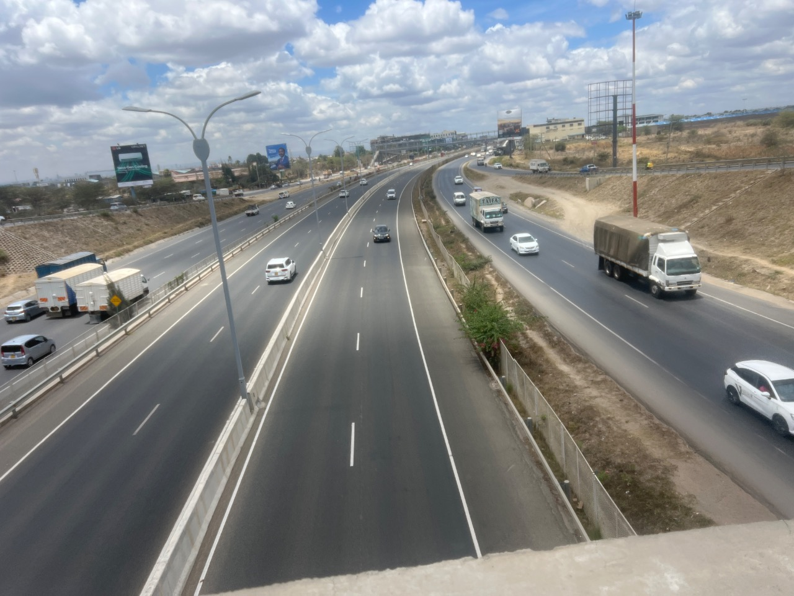

**OCTOBER 2026  **

<table>
<colgroup>
<col style="width: 49%" />
<col style="width: 50%" />
</colgroup>
<thead>
<tr>
<th>
DIRECTOR GENERAL

KENYA NATIONAL HIGHWAYS AUTHORITY

P.O.BOX 49712-0100

<strong><u>NAIROBI</u></strong>
</th>
<th>
DIRECTORATE OF PLANNING RESEARCH &amp; COMPLIANCE

P.O.BOX 49712-0100

<strong><u>NAIROBI</u></strong>
</th>
</tr>
</thead>
<tbody>
</tbody>
</table>

**TABLE OF CONTENTS**

EXECUTIVE SUMMARY v

1.0 INTRODUCTION 1

1.1 Exercise Description 1

1.2 Objectives of the Exercise 3

1.2.1 Main Objective 3

1.2.2 Specific Objectives 3

2.0 SCOPE OF WORK 4

3.0 METHODOLOGY 5

3.1 Review of Existing Information 5

3.2 Selection Criteria of the 60 Proposed CTC Stations 5

3.3 Selection of Locations for the First Validation Phase 6

3.4 Station and Coordinate Validation 6

3.5 Assessment of Site Suitability 6

3.6 Classified Traffic Counting 6

4.0 SITE VALIDATION AND FINDINGS 7

4.1 East Station Findings 7

4.2 West Station Findings 10

4.3 Site Suitability Assessment 12

4.3.1 East Site Suitability Matrix 12

4.3.2 West Site Suitability Matrix 13

4.4 Summary of Outcomes 14

5.0 TRAFFIC COUNT ANALYSIS 15

6.0 CONCLUSIONS 16

7.0 RECOMMENDATIONS 17

APPENDIX A STATION SELECTION AND PROPOSED 60 STATIONS 18

A.1 Detailed Desktop Scoring Rules 18

A.2 Selected Stations East 20

A.3 Selected Stations West 25

APPENDIX B MAPS OF THE PROPOSED CTC STATIONS 29

APPENDIX C KOBO SITE VALIDATION FORM 32

APPENDIX D TRAFFIC COUNT ANALYSIS SUMMARIES 36

D.1 East Analysis Summary 36

D.2 West Analysis Summary 37

APPENDIX E SELECTED SITE PHOTOGRAPHS 38

**LIST OF TABLES**

[Table 1.1 Stations visited during first-phase validation
[2](#tab1)](#tab1)

[Table 3.1 Desktop selection criteria and maximum scores
[5](#tab2)](#tab2)

[Table 4.1 East station location validation findings [7](#tab5)](#tab5)

[Table 4.2 West station location validation findings [10](#tab6)](#tab6)

Table 4.3 Summary of field validation outcomes
[14](#SummaryOutcomesTable)

[Table 5.1 East observed and estimated traffic volumes
[15](#_Toc243311254)](#_Toc243311254)

[Table 5.2 West observed and estimated traffic volumes
[15](#_Toc243311255)](#_Toc243311255)

[Table A.1 Detailed desktop scoring rules [18](#tab7)](#tab7)

[Table A.2 East stations selection scores and field status
[20](#tab9)](#tab9)

[Table A.3 West stations selection scores and field status
[25](#tab10)](#tab10)

Table D.1 East traffic count analysis summary 36

Table D.2 West traffic count analysis summary 37

**LIST OF FIGURES**

[Figure B.1 National map of the 60 proposed stations [29](#fig1)](#fig1)

[Figure B.2 Proposed East stations [30](#fig2)](#fig2)

[Figure B.3 Proposed West stations [31](#fig3)](#fig3)

Figure E.1 Kokotoni (A8) 38

Figure E.2 Mukuyuni (B63) 38

Figure E.3 Maungu (A8) 38

Figure E.4 Mwanjila Youth Polytechnic (A6) 38

Figure E.5 Kereri (B6) 39

Figure E.6 Bukembe (A8) 39

Figure E.7 Chimoi (A8) 39

Figure E.8 Molem (A1) 39

**LIST OF ABBREVIATIONS**

| AADT   | Annual Average Daily Traffic                       |
|--------|----------------------------------------------------|
| ADT    | Average Daily Traffic                              |
| CTC    | Continuous Traffic Count                           |
| ESA    | Equivalent Standard Axle                           |
| GIS    | Geographic Information System                      |
| GPS    | Global Positioning System                          |
| HEF    | Hourly Expansion Factor                            |
| ICTMP  | Integrated Continuous Traffic Monitoring Programme |
| KeNHA  | Kenya National Highways Authority                  |
| NMT    | Non-Motorised Transport                            |
| O–D    | Origin–Destination                                 |
| TVC    | Traffic Volume Count                               |
| UTM    | Universal Transverse Mercator                      |
| VWB    | Virtual Weighbridge                                |
| WGS 84 | World Geodetic System 1984                         |

# EXECUTIVE SUMMARY

This report presents the findings of an exercise undertaken by the Kenya
National Highways Authority to validate selected 2023 traffic census
records and assess locations for permanent Continuous Traffic Count
(CTC) stations. The exercise sought to confirm station locations,
compare field traffic counts with the historical data and identify
conditions affecting future monitoring.

A desktop review of the 460 stations from the 2023 records identified 60
proposed stations, comprising 30 in East and 30 in West. 24 stations
were visited during the first validation phase, with 12 covered in each
lot. The visits involved checking road references and landmarks,
recording coordinates, assessing road and roadside conditions, taking
photographs and conducting one-hour classified traffic counts.

The location assessments identified differences between some registered
coordinates and the positions considered appropriate on the ground.
Several stations required relocation to avoid junctions, bends, bus
stops, school entrances, petrol-station accesses and other local
influences.

The traffic analysis compared the observed one-hour volumes with the
2023 hourly data. Direction-specific hourly expansion factors were then
used to estimate daily volumes for comparison with the 2023 24-hour
counts.

At Mukuyuni, no vehicles were recorded during the one-hour observation.
Its inclusion among the proposed 60 stations should be reviewed through
a confirmatory count and consideration of the road section it
represents. Across the visited locations, the suitability matrix
recorded 19 stations as suitable and 5 as not suitable.

If the first phase of CTC installation proceeds, Gateway Mall Syokimau,
Kokotoni, Mtito Andei and Matsangoni in East, and Kereri, Eldoret–Nakuru
(A8), Molem and Bukembe in West, are recommended for prioritisation,
subject to confirmation of suitable equipment positions and resolution
of the recorded constraints.

# 1.0 INTRODUCTION

The Kenya National Highways Authority (KeNHA) undertook a National
Traffic Survey in 2023, which identified approximately 460 traffic
census points across the road network. The survey provides a reference
for traffic monitoring, transport planning, pavement design, maintenance
programming, road asset management and economic evaluation of road
projects.

To build on the survey, the Planning and Road Management Department
intends to establish permanent Continuous Traffic Count (CTC) stations
at selected locations. Continuous monitoring will complement periodic
surveys by recording changes in traffic volumes and vehicle composition.
This will provide a stronger basis for estimating Annual Average Daily
Traffic (AADT), assessing traffic growth and loading patterns, and
determining road investment and maintenance needs.

The proposed stations form part of the Integrated Continuous Traffic
Monitoring Programme (ICTMP). The programme seeks to bring together
information from existing traffic census stations, Virtual Weighbridges,
static weighbridges and new permanent counters. This approach will
support the use of available datasets while identifying road sections
where additional monitoring is needed.

A desktop review of the 2023 census records identified 60 candidate CTC
stations nationally, comprising 30 in East and 30 in West. The first
phase of field validation covered 24 of the 60 locations, with 12
assessed in both East and West. The locations included major trunk-road
sections and selected regional links representing different traffic and
operating conditions.

Field validation was necessary because a position previously used for a
temporary manual count may not meet the requirements of a permanent
monitoring installation. Road improvements, roadside development and
changes in access or traffic movements may also affect the suitability
of the original census position. Each location therefore required
assessment of its ability to capture representative traffic and
accommodate equipment that can be safely installed, operated and
maintained.

The exercise involved verification of station positions, capture of
field coordinates, inspection of road and roadside conditions,
photographic documentation and classified traffic counting. Where
constraints affected the original position, an adjusted location was
recorded or further assessment of an alternative position was
recommended.

This report presents the findings from the field validation of 24
proposed CTC stations, comprising 12 locations in East and 12 in West.
It compares the station information recorded in the Traffic Census
Register with the coordinates and site conditions observed during the
field exercise. The report identifies stations that may be retained,
relocated or subjected to further technical assessment and provides
recommendations to support the selection of suitable locations for the
proposed CTC network. The findings will also support the review and
updating of the Traffic Census Register and the GIS Traffic Monitoring
Database.

## 1.1 Exercise Description

The exercise comprised desktop selection of 60 candidate CTC stations
nationally, with 30 in East and 30 in West, followed by first-phase
field validation of 24 locations. The remaining 36 candidates were
retained for subsequent validation. Appendix A gives the selected
stations

and the selection basis.

The East validated locations were on A5, A6, A7, A8 and B63. The West
validated locations were on A1, A8, A12, B3 and B6.

| **No.** | **East**                   | **West**       |
|---------|----------------------------|----------------|
| 1       | Matsangoni                 | Isebania       |
| 2       | Ukunda                     | Kogwe          |
| 3       | Lunga Lunga Police         | Kereri         |
| 4       | Kokotoni                   | Oyugis         |
| 5       | Mkomani                    | Bumala         |
| 6       | Maungu                     | Bukembe        |
| 7       | Mwanjila Youth Polytechnic | Kiungani       |
| 8       | Mtito Andei                | Webuye         |
| 9       | Kiboko                     | Chimoi         |
| 10      | Kimana                     | Eldoret–Nakuru |
| 11      | Mukuyuni                   | Molem          |
| 12      | Gateway Mall Syokimau      | Awasi          |

**Table 1.1 Stations visited
during first-phase validation**

At each station, the team located the registered census point and
inspected the surrounding road and roadside conditions. The assessment
considered visibility, alignment, gradients, lane configuration and
features that could influence traffic passing the counting position.

The teams also reviewed access for installation and maintenance,
available roadside space, drainage, security, lighting and mobile
network availability. Coordinates, landmarks, photographs and site
observations were recorded using the KoboToolbox validation form.

Where the original position was affected by unsuitable geometry or local
traffic movements, the team identified an adjusted position along the
road section and recorded the reason for relocation. Classified traffic
counts were undertaken alongside the site inspections to record traffic
during the survey period and support subsequent comparison with
historical records.

## 1.2 Objectives of the Exercise

### 1.2.1 Main Objective

To validate selected 2023 traffic census locations and supporting
traffic records, and assess their suitability for permanent Continuous
Traffic Count monitoring.

### 1.2.2 Specific Objectives

1\. To verify station positions, road references and identifiers against
the traffic census register.

2\. To assess whether the locations represent the intended traffic flow
and are suitable in terms of road geometry, visibility and roadside
conditions for establishment of permanent Continous Traffic Count
Stations.

3\. To assess access, safety, security, drainage, potential power supply
and network requirements for permanent monitoring.

4\. To establish traffic volumes and vehicle composition during the
field survey periods and compare them with historical records.

5\. To review potential duplication with existing weighbridge
monitoring.

# 2.0 SCOPE OF WORK

The exercise comprised the desktop selection of 60 proposed Continuous
Traffic Count stations across the country and field validation of 24
locations during the first phase. The 60 stations consisted of 30
stations in East and 30 in West, of which 12 from each group were
assessed on the ground in the first phase.

**1. Review of existing traffic census records**

Examination of the 2023 census records, station coordinates, road
sections, historical AADT and available vehicle classification and
axle-loading information to establish the proposed 60 CTC stations.

**2. Selection of the 60 proposed CTC stations**

Assessment using traffic volumes, freight or axle-loading, road
classification, completeness of historical data, existing monitoring
coverage and road-section coverage. The stations were reviewed for
national distribution and representation of distinct traffic links.
Class A roads were prioritised, with selected Class B stations included
where justified by their contribution to network coverage.

**3. Planning of the first validation phase**

Identification of 24 locations from the proposed 60 stations, comprising
12 in East and 12 in West, and preparation of field schedules taking
account of road-link coverage and travel logistics.

**4. Verification of station locations**

Identification of the selected points on the ground, confirmation of
road references and landmarks, and capture of field coordinates for
comparison with the register.

**5. Assessment of site suitability**

Inspection of road geometry, visibility, lane configuration and nearby
activities that could affect representative counting. Access, roadside
space, drainage, flood exposure, security, lighting, mobile network
availability and visible power infrastructure were also considered.

**6. Identification of revised positions**

Recording of adjusted locations where constraints affected the original
census positions, together with the reasons for relocation and
recommendations for further assessment where necessary.

**7. Classified traffic counting and analysis**

Collection of classified counts during the survey periods to establish
observed volumes and vehicle composition and support comparison with
historical records.

# 3.0 METHODOLOGY

The assignment was undertaken in two stages: desktop selection of the 60
proposed CTC stations and field validation of 24 locations during the
first phase. The methodology combined review of historical traffic
records, mapping, site inspections, coordinate capture and classified
traffic counting.

## 3.1 Review of Existing Information

The 2023 traffic census records were reviewed to establish 60 candidate
stations. Information examined included station names and codes, road
sections, road classification, registered coordinates, historical AADT
and available vehicle classification and axle-loading data.

The station coordinates were mapped against the road network to examine
their distribution and support field planning. Location of Virtual
Weighbridges was also considered when reviewing existing monitoring
coverage to prevent coverage overlap.

## 3.2 Selection Criteria of the 60 Proposed CTC Stations

<table>
<caption>
<strong>Table 3.1
Desktop selection criteria and maximum scores</strong>
</caption>
<colgroup>
<col style="width: 26%" />
<col style="width: 10%" />
<col style="width: 62%" />
</colgroup>
<thead>
<tr>
<th><strong>Criterion</strong></th>
<th><strong>Max. 
points</strong></th>
<th><strong>Basis</strong></th>
</tr>
</thead>
<tbody>
<tr>
<td>Strategic importance of the road link</td>
<td>15</td>
<td>Priority was given to major trunk corridors, international
approaches and links serving important regional traffic movements.</td>
</tr>
<tr>
<td>Representativeness of the location</td>
<td>10</td>
<td>Road-section length, apparent influence of settlements or junctions,
and alignment of the registered coordinates with the mapped road were
considered.</td>
</tr>
<tr>
<td>Historical AADT</td>
<td>10</td>
<td>Stations were scored according to the percentile ranking of their
AADT values.</td>
</tr>
<tr>
<td>Freight share or axle-loading indicator</td>
<td>5</td>
<td>Recorded freight share was used for West. Recorded daily Equivalent
Standard Axles (ESA) were used as a loading indicator for East, where an
equivalent freight-share field was unavailable. Missing values received
zero points.</td>
</tr>
<tr>
<td>Gap in existing monitoring coverage</td>
<td>5</td>
<td>Estimated road-network distance to a Virtual Weighbridge on the same
road was used to assess additional monitoring coverage.</td>
</tr>
<tr>
<td>Completeness of historical survey data</td>
<td>3</td>
<td>Higher scores were assigned where classified traffic counts were
supported by additional surveys, including axle loading,
origin–destination, non-motorised transport or emissions surveys.</td>
</tr>
<tr>
<td>Geographic coverage</td>
<td>2</td>
<td>A small weighting recognised road and county combinations with fewer
candidate records, supporting a wider distribution of monitoring
locations.</td>
</tr>
<tr>
<td>Total</td>
<td>50</td>
<td></td>
</tr>
</tbody>
</table>

## 3.3 Selection of Locations for the First Validation Phase

From the 60 Proposed CTC Stations, 24 locations were selected for
first-phase validation using road-link priorities and field logistics.
The field assessment covered 24 proposed CTC locations, comprising 12 in
East and 12 in West.

East prioritised A7 and A8 and associated coastal links, with additional
coverage on A5, A6 and B63. West covered A1, A8, A12, B3 and B6 around
the western and lake-region network.

The other 36 remained pending validation in other phases.

## 3.4 Station and Coordinate Validation

The teams used the registered coordinates and road references to
identify each census location on the ground. Field coordinates, nearby
landmarks and site observations were recorded using the KoboToolbox
validation form attached in Appendix C.

Kobo coordinates were recorded as latitude and longitude using
mobile-phone GPS.

## 3.5 Assessment of Site Suitability

Each location was inspected to determine whether it could capture
representative traffic and accommodate permanent monitoring equipment
such as cameras and pneumatic counters. The assessment considered:

- Road alignment, bends, gradients, climbing lanes and lane
  configuration.

- Visibility of approaching and passing traffic across the lanes to be
  monitored.

- The influence of junctions, access roads, bus stops, school entrances,
  markets, petrol stations and other roadside activities.

- Available roadside space, parking and access for installation and
  maintenance.

- Drainage, flood exposure, security and lighting.

- Mobile network availability and visible infrastructure indicating
  potential power supply.

Where constraints affected the original position, an adjusted location
was identified along the road section or further assessment of an
alternative position was recommended.

## 3.6 Classified Traffic Counting

Classified traffic counts were undertaken using the traffic count form
alongside the site assessments. For analysis, station identifiers,
survey dates, start and finish times, direction labels and vehicle
categories were reconciled with the historical records.

# 4.0 SITE VALIDATION AND FINDINGS

The field assessment covered 24 proposed CTC locations, comprising 12 in
East and 12 in West. The assessment compared the registered census
positions with actual field coordinates and examined suitability for
permanent traffic monitoring.

## 4.1 East Station Findings

<table>
<caption>
<strong>Table 4.1 East
station location validation findings</strong>
</caption>
<colgroup>
<col style="width: 3%" />
<col style="width: 15%" />
<col style="width: 12%" />
<col style="width: 12%" />
<col style="width: 10%" />
<col style="width: 10%" />
<col style="width: 34%" />
</colgroup>
<thead>
<tr>
<th><strong>No.</strong></th>
<th><strong>Station and reference</strong></th>
<th style="text-align: center;"><strong>Road</strong></th>
<th><strong>Road section</strong></th>
<th><strong>Field latitude 
longitude</strong></th>
<th><strong>Register latitude 
longitude</strong></th>
<th><strong>Assessment of location</strong></th>
</tr>
</thead>
<tbody>
<tr>
<td>1</td>
<td>Lunga Lunga Police Station 
CST_002_A7_013 
Class A | Coast</td>
<td style="text-align: center;">A7</td>
<td>Horo Horo–Mgombezi Junction</td>
<td>-4.559504 
39.127508</td>
<td>-4.559065 
39.127179</td>
<td>Field and register coordinates are relatively close. The police
station landmark supports identification. A nearby junction and bus stop
may influence traffic at the proposed monitoring position.</td>
</tr>
<tr>
<td>2</td>
<td>Ukunda 
CST_002_A7_015 
Class A | Coast</td>
<td style="text-align: center;">A7</td>
<td>Mwabungu–Kombani</td>
<td>-4.267670 
39.569747</td>
<td>-4.267123 
39.569808</td>
<td>Field and register coordinates are relatively close. The road
section and Shell petrol station landmark support identification.</td>
</tr>
<tr>
<td>3</td>
<td>Mkomani 
CST_003_A7_026 
Class A | Coast</td>
<td style="text-align: center;">A7</td>
<td>Mtwapa–Mavueni</td>
<td>-3.754709 
39.823900</td>
<td>-3.748254 
39.823878</td>
<td>Field and register coordinates are relatively close</td>
</tr>
<tr>
<td>4</td>
<td>Matsangoni 
CST_003_A7_024 
Class A | Coast</td>
<td style="text-align: center;">A7</td>
<td>Tezo–Malindi</td>
<td>-3.388110 
39.925556</td>
<td>-3.388980 
39.925030</td>
<td>Monitoring location was shifted approximately 300 m from the
registered position because the original position lies within a
forest.</td>
</tr>
<tr>
<td>5</td>
<td>Kokotoni 
CST_002_A8_017 
Class A | Coast</td>
<td style="text-align: center;">A8</td>
<td>Mazeras–Mariakani</td>
<td>-3.922762 
39.528830</td>
<td>-3.922203 
39.527158</td>
<td>Field and register coordinates are relatively close. The road
section and Kokotoni petrol station landmark support
identification.</td>
</tr>
<tr>
<td>6</td>
<td>Maungu 
CST_006_A8_043 
Class A | Corridor A</td>
<td style="text-align: center;">A8</td>
<td>Mariakani–Voi</td>
<td>-3.559300 
38.752561</td>
<td>-3.558135 
38.750254</td>
<td>Monitoring location was moved approximately 300 m from the
registered position to avoid turning movements at a roadside station and
interference from a boda boda shed.</td>
</tr>
<tr>
<td>7</td>
<td>Mwanjila Youth Polytechnic 
CST_006_A6_042 
Class A | Corridor A</td>
<td style="text-align: center;">A6</td>
<td>Holili–Voi</td>
<td>-3.497912 
38.314440</td>
<td>-3.500654 
38.317664</td>
<td>Field and register coordinates are relatively close. The road
section and polytechnic landmark support identification.</td>
</tr>
<tr>
<td>8</td>
<td>Kimana 
NRB_034_A5_152 
Class A | Lower Eastern</td>
<td style="text-align: center;">A5</td>
<td>Amboseli Junction–Mbirikani</td>
<td>-2.813108 
37.531745</td>
<td>-2.812288 
37.531664</td>
<td>Field and register coordinates are relatively close. The road
section and AIC Bethel Church landmark support identification. Shoulder
erosion was reported at the location.</td>
</tr>
<tr>
<td>9</td>
<td>Mtito Andei 
LEST_017_A8_110 
Class A | Corridor A</td>
<td style="text-align: center;">A8</td>
<td>Tsavo–Kibwezi</td>
<td>-2.689942 
38.163202</td>
<td>-2.693016 
38.166215</td>
<td>Monitoring location was moved approximately 500 m from the
registered position to avoid turning movements at a nearby petrol
station.</td>
</tr>
<tr>
<td>10</td>
<td>Kiboko 
LEST_017_A8_109 
Class A | Corridor A</td>
<td style="text-align: center;">A8</td>
<td>Kibwezi–Emali</td>
<td>-2.211328 
37.715083</td>
<td>-2.211070 
37.715880</td>
<td>Field and register coordinates are relatively close. The road
section and Trojans petrol station landmark support identification.</td>
</tr>
<tr>
<td>11</td>
<td>Mukuyuni 
LEST_016_B63_106 
Class B | Lower Eastern</td>
<td style="text-align: center;">B63</td>
<td>Kanyuuku–Kangundo</td>
<td>-1.342423 
37.390939</td>
<td>-1.342260 
37.390949</td>
<td>Field and register coordinates closely agree. The road section and
Mukuyuni Primary School landmark support identification. Very low
traffic volumes were observed on the gravel road. Reconsider the
location’s priority for a permanent CTC station.</td>
</tr>
<tr>
<td>12</td>
<td>Gateway Mall Syokimau 
LEST_016_A8_098 
Class A | Corridor A</td>
<td style="text-align: center;">A8</td>
<td>Kitengela Interchange–Cabanas</td>
<td>-1.361993 
36.909173</td>
<td>-1.364105 
36.911337</td>
<td>Field and register coordinates are relatively close. The Gateway
Mall landmark supports identification.</td>
</tr>
</tbody>
</table>

## 4.2 West Station Findings

<table>
<caption>
<strong>Table 4.2 West
station location validation findings</strong>
</caption>
<colgroup>
<col style="width: 3%" />
<col style="width: 15%" />
<col style="width: 12%" />
<col style="width: 12%" />
<col style="width: 10%" />
<col style="width: 10%" />
<col style="width: 34%" />
</colgroup>
<thead>
<tr>
<th style="text-align: center;"><strong>No.</strong></th>
<th style="text-align: center;"><strong>Station and
reference</strong></th>
<th style="text-align: center;"><strong>Road</strong></th>
<th style="text-align: center;"><strong>Road section</strong></th>
<th style="text-align: center;"><strong>Field latitude 
longitude</strong></th>
<th style="text-align: center;"><strong>Register latitude 
longitude</strong></th>
<th style="text-align: center;"><strong>Assessment of
location</strong></th>
</tr>
</thead>
<tbody>
<tr>
<td>1</td>
<td>Isebania 
A1.TCP23 
Class A | Nyanza</td>
<td style="text-align: center;">A1</td>
<td>Suna–Isebania</td>
<td>-1.109526 
34.455147</td>
<td>-1.109511 
34.455263</td>
<td>Field and register coordinates are close. Electricity poles are
present, but street lighting is unavailable.</td>
</tr>
<tr>
<td>2</td>
<td>Kogwe 
B3.TCP1 
Class B | Nyanza</td>
<td style="text-align: center;">B3</td>
<td>Homa Bay–Rongo</td>
<td>-0.638262 
34.514674</td>
<td>-0.638525 
34.515352</td>
<td>The location was moved approximately 100m to avoid a junction, bus
stop and curve.</td>
</tr>
<tr>
<td>3</td>
<td>Kereri 
B6.TCP1 
Class B | Corridor B</td>
<td style="text-align: center;">B6</td>
<td>Kisii–Keumbu</td>
<td>-0.684632 
34.780310</td>
<td>-0.684482 
34.779651</td>
<td>The location was moved approximately 100m to reduce the influence of
the school entrance.</td>
</tr>
<tr>
<td>4</td>
<td>Oyugis 
A1.TCP20 
Class A | Nyanza</td>
<td style="text-align: center;">A1</td>
<td>Katito–Kisii</td>
<td>-0.456604 
34.878624</td>
<td>-0.456735 
34.878366</td>
<td>The location was moved approximately 100m to avoid a bus stop, a
curve on the approach from Kisii and turning movements at an access
road.</td>
</tr>
<tr>
<td>5</td>
<td>Bumala 
A12.TCP1 
Class A | Corridor B</td>
<td style="text-align: center;">A12</td>
<td>Busia–Ugunja</td>
<td>0.311518 
34.199006</td>
<td>0.308461 
34.200286</td>
<td>The location was moved approximately 400m because of a nearby
junction and bend within a reported accident blackspot.</td>
</tr>
<tr>
<td>6</td>
<td>Bukembe 
A8.TCP1 
Class A | Corridor B</td>
<td style="text-align: center;">A8</td>
<td>Malaba–Webuye</td>
<td>0.608049 
34.645315</td>
<td>0.607516 
34.644629</td>
<td>The location was moved approximately 200m because of a steep climb
towards Malaba. Proximity to Webuye weighbridge.</td>
</tr>
<tr>
<td>7</td>
<td>Kiungani 
A1.TCP9 
Class A | Western</td>
<td style="text-align: center;">A1</td>
<td>Kitale–Kamukuywa</td>
<td>0.934762 
34.947087</td>
<td>0.934026 
34.947045</td>
<td>Field and register positions were described as close. Electricity is
reported as available, but street lighting is absent.</td>
</tr>
<tr>
<td>8</td>
<td>Webuye 
A1.TCP10 
Class A | Western</td>
<td style="text-align: center;">A1</td>
<td>Kamukuywa–Malava</td>
<td>0.612022 
34.761017</td>
<td>0.612528 
34.761062</td>
<td>An alternative location is recommended because of a nearby junction
and bend. Only a few streetlights are functional. Assess an alternative
position and potential overlap with weighbridge monitoring.</td>
</tr>
<tr>
<td>9</td>
<td>Chimoi 
A8.TCP3 
Class A | Corridor B</td>
<td style="text-align: center;">A8</td>
<td>Jn A1 Chimoi–Eldoret Maili Tisa</td>
<td>0.576084 
34.810209</td>
<td>0.575478 
34.824246</td>
<td>The location was moved approximately 1.5km towards the interchange
to avoid sharp bends. Road marking works were ongoing.</td>
</tr>
<tr>
<td>10</td>
<td>Eldoret–Nakuru 
A8.TCP7 
Class A | Corridor B</td>
<td style="text-align: center;">A8</td>
<td>Ngeria–Timboroa–Mau Summit</td>
<td>0.091203 
35.509987</td>
<td>0.094013 
35.507847</td>
<td>Field and register coordinates are relatively close.Electricity is
reported as present, but streetlights are absent. Confirm the monitoring
position and power arrangements.</td>
</tr>
<tr>
<td>11</td>
<td>Molem 
A1.TCP18 
Class A | Nyanza</td>
<td style="text-align: center;">A1</td>
<td>Nyamasaria–Ahero</td>
<td>-0.146415 
34.804520</td>
<td>-0.136500 
34.796658</td>
<td>The location was moved 1.2km away from petrol stations to reduce
turning-movement influence. River-overflow flooding was reported. Assess
flood exposure before confirming the equipment position.</td>
</tr>
<tr>
<td>12</td>
<td>Awasi 
A12.TCP6 
Class A | Corridor B</td>
<td style="text-align: center;">A12</td>
<td>Ahero–Kapsoit</td>
<td>-0.236809 
35.155144</td>
<td>-0.225822 
35.155031</td>
<td>The location was moved 1km towards Kapsoit to avoid the town centre
and climbing-lane section. Confirm the revised position against lane
configuration, visibility and nearby accesses.</td>
</tr>
</tbody>
</table>

## 4.3 Site Suitability Assessment The suitability matrix summarises the conditions recorded at each station during the field assessment, using the KoboToolbox validation form. 

### 4.3.1 East Site Suitability Matrix

Recorded Kobo responses for 12 East stations.

| **Station** | **Visibility adequate** | **Clear of sharp bends** | **Free of steep gradient** | **Away from junctions** | **Away from bus stages** | **Away from markets** | **No road works** | **Security acceptable** | **Mobile network** | **Lighting** | **Drainage adequate** | **Emergency access** | **Sign space** | **Constraints** | **Suitability** |
|----|:--:|:--:|:--:|:--:|:--:|:--:|:--:|:--:|:--:|:--:|:--:|:--:|:--:|:--:|:--:|
| Lunga Lunga Police Station | ✓ | ✗ | ✗ | ✗ | ✗ | ✗ | ✓ | ✓ | ✓ | ✓ | ✗ | ✗ | ✓ | 7 | Not Suitable |
| Ukunda | ✓ | ✓ | ✓ | ✓ | ✗ | ✓ | ✓ | ✓ | ✓ | ✓ | ✗ | ✓ | ✗ | 3 | Suitable |
| Mkomani | ✓ | ✓ | ✓ | ✓ | ✓ | ✓ | ✓ | ✓ | ✓ | ✗ | ✗ | ✗ | ✓ | 3 | Suitable |
| Matsangoni | ✓ | ✓ | ✓ | ✓ | ✓ | ✓ | ✓ | ✓ | ✓ | ✗ | ✗ | ✓ | ✗ | 3 | Suitable |
| Kokotoni | ✓ | ✓ | ✓ | ✓ | ✓ | ✓ | ✗ | ✓ | ✓ | ✗ | ✓ | ✓ | ✓ | 2 | Suitable |
| Maungu | ✓ | ✓ | ✓ | ✓ | ✗ | ✓ | ✓ | ✓ | ✓ | ✓ | ✗ | ✓ | ✓ | 2 | Suitable |
| Mwanjila Youth Polytechnic | ✓ | ✗ | ✗ | ✓ | ✓ | ✓ | ✓ | ✓ | ✓ | ✗ | ✗ | ✗ | ✓ | 5 | Not Suitable |
| Kimana | ✓ | ✓ | ✓ | ✓ | ✓ | ✓ | ✓ | ✓ | ✓ | ✗ | ✗ | ✓ | ✓ | 2 | Suitable |
| Mtito Andei | ✓ | ✓ | ✓ | ✓ | ✓ | ✓ | ✓ | ✓ | ✓ | ✗ | ✗ | ✗ | ✓ | 3 | Suitable |
| Kiboko | ✓ | ✓ | ✓ | ✓ | ✓ | ✓ | ✓ | ✓ | ✓ | ✗ | ✗ | ✗ | ✓ | 3 | Suitable |
| Mukuyuni | ✓ | ✗ | ✓ | ✓ | ✓ | ✓ | ✓ | ✗ | ✓ | ✗ | ✗ | ✗ | ✗ | 6 | Not suitable |
| Gateway Mall Syokimau | ✓ | ✓ | ✓ | ✓ | ✓ | ✓ | ✓ | ✓ | ✓ | ✗ | ✗ | ✓ | ✗ | 3 | Suitable |

Key: ✓ = favourable response; ✗ = constraint recorded; — = not
recorded.  
Not Suitable: More than 3 Constraints, Suitable: Less than 3 Constraints

### 4.3.2 West Site Suitability Matrix

Recorded Kobo responses for 12 West stations.

| **Station** | **Visibility adequate** | **Clear of sharp bends** | **Free of steep gradient** | **Away from junctions** | **Away from bus stages** | **Away from markets** | **No road works** | **Security acceptable** | **Mobile network** | **Lighting** | **Drainage adequate** | **Emergency access** | **Sign space** | **Constraints** | **Suitability** |
|----|:--:|:--:|:--:|:--:|:--:|:--:|:--:|:--:|:--:|:--:|:--:|:--:|:--:|:--:|:--:|
| Isebania | ✓ | ✓ | ✓ | ✓ | ✓ | ✓ | ✓ | ✓ | ✓ | ✗ | ✓ | ✓ | ✓ | 1 | Suitable |
| Kogwe | ✓ | ✓ | ✓ | ✓ | ✓ | ✓ | ✓ | ✓ | ✓ | ✗ | ✓ | ✓ | ✓ | 1 | Suitable |
| Kereri | ✓ | ✓ | ✓ | ✓ | ✓ | ✓ | ✓ | ✓ | ✓ | ✓ | ✓ | ✓ | ✓ | 0 | Suitable |
| Oyugis | ✓ | ✓ | ✓ | ✓ | ✗ | ✓ | ✓ | ✓ | ✓ | ✗ | ✓ | ✓ | ✓ | 2 | Suitable |
| Bumala | ✓ | ✓ | ✓ | ✓ | ✓ | ✓ | ✓ | ✓ | ✓ | ✗ | ✓ | ✓ | ✓ | 1 | Suitable |
| Bukembe | ✓ | ✓ | ✗ | ✓ | ✓ | ✓ | ✓ | ✓ | ✓ | ✗ | ✓ | ✓ | ✓ | 2 | Suitable |
| Kiungani | ✓ | ✓ | ✓ | ✓ | ✓ | ✓ | ✓ | ✓ | ✓ | ✗ | ✓ | ✓ | ✓ | 1 | Suitable |
| Webuye | ✓ | ✗ | ✓ | ✗ | ✓ | ✗ | ✓ | ✓ | ✓ | ✗ | ✓ | ✓ | ✓ | 4 | Not suitable |
| Chimoi | ✓ | ✗ | ✓ | ✗ | ✓ | ✓ | ✗ | ✓ | ✓ | ✗ | ✓ | ✓ | ✓ | 4 | Not Suitable |
| Eldoret–Nakuru | ✓ | ✗ | ✗ | ✓ | ✓ | ✓ | ✓ | ✓ | ✓ | ✗ | ✓ | ✓ | ✓ | 3 | Suitable |
| Molem | ✓ | ✓ | ✓ | ✓ | ✓ | ✓ | ✓ | ✓ | ✓ | ✗ | ✗ | ✓ | ✓ | 2 | Suitable |
| Awasi | ✓ | ✓ | ✓ | ✓ | ✓ | ✓ | ✓ | ✓ | ✓ | ✗ | ✓ | ✓ | ✓ | 1 | Suitable |

Key: ✓ = favourable response; ✗ = constraint recorded; — = not recorded.

## 4.4 Summary of Outcomes

The first phase covered 24 of the 60 proposed CTC stations, comprising
12 in East and 12 in West. Table 4.3 summarises the outcomes recorded in
the station assessments and site suitability matrices.

**Table 4.3
Summary of field validation outcomes**

| **Assessment outcome**                         | **East** | **West** | **Total** |
|------------------------------------------------|:--------:|:--------:|:---------:|
| Stations assessed                              |    12    |    12    |    24     |
| Registered position retained                   |    9     |    3     |    12     |
| Position adjusted within the same road section |    3     |    8     |    11     |
| Alternative position recommended               |    0     |    1     |     1     |
| Rated suitable                                 |    9     |    10    |    19     |
| Rated not suitable                             |    3     |    2     |     5     |
| Drainage inadequate or absent                  |    11    |    1     |    12     |
| Lighting available                             |    3     |    1     |     4     |
| Security assessed as acceptable                |    11    |    12    |    23     |
| Mobile network availability reported           |    12    |    12    |    24     |
| Emergency access available                     |    6     |    12    |    18     |
| Space for signs available                      |    8     |    12    |    20     |

The five stations rated not suitable were Lunga Lunga Police Station,
Mwanjila Youth Polytechnic and Mukuyuni in East, and Webuye and Chimoi
in West. The ratings reflect the recorded constraints.

An alternative position was recommended at Webuye. Potential overlap
with static weighbridge monitoring was noted at Bukembe and Webuye. The
remaining 36 candidate stations, comprising 18 in East and 18 in West,
await field validation.

# 5.0 TRAFFIC COUNT ANALYSIS

This section presents the one-hour traffic counts recorded at the East
and West stations and their comparison with the 2023 survey records.
Direction-specific hourly expansion factors derived from the historical
data were applied to estimate daily traffic volumes. Tables 5.1 and 5.2
show the observed counts, historical reference volumes, estimated daily
volumes and percentage differences between the estimated daily volumes
and the 2023 24-hour totals. Supporting calculations are provided in
Appendix D.

<table>
<caption>
<strong>Table 5.1 East observed and estimated traffic
volumes</strong>
</caption>
<colgroup>
<col style="width: 17%" />
<col style="width: 20%" />
<col style="width: 13%" />
<col style="width: 10%" />
<col style="width: 9%" />
<col style="width: 10%" />
<col style="width: 10%" />
<col style="width: 7%" />
</colgroup>
<thead>
<tr>
<th><strong>Station</strong></th>
<th><strong>Station code</strong></th>
<th style="text-align: center;"><strong>Count hour</strong></th>
<th style="text-align: center;"><strong>Observed 
1-hour</strong></th>
<th style="text-align: center;"><strong>2023 
reference hour</strong></th>
<th style="text-align: center;"><strong>2023 
24-hour</strong></th>
<th style="text-align: center;"><strong>Estimated 
ADT</strong></th>
<th style="text-align: center;"><strong>Change 
(%)</strong></th>
</tr>
</thead>
<tbody>
<tr>
<td>Matsangoni</td>
<td>CST_003_A7_024</td>
<td style="text-align: center;">09:00–10:00</td>
<td style="text-align: center;">532</td>
<td style="text-align: center;">401</td>
<td style="text-align: center;">5,698</td>
<td style="text-align: center;">7,590</td>
<td style="text-align: center;">+33.2</td>
</tr>
<tr>
<td>Ukunda</td>
<td>CST_002_A7_015</td>
<td style="text-align: center;">09:00–10:00</td>
<td style="text-align: center;">1,395</td>
<td style="text-align: center;">638</td>
<td style="text-align: center;">11,046</td>
<td style="text-align: center;">24,180</td>
<td style="text-align: center;">+118.9</td>
</tr>
<tr>
<td>Lunga Lunga Police Station</td>
<td>CST_002_A7_013</td>
<td style="text-align: center;">13:00–14:00</td>
<td style="text-align: center;">251</td>
<td style="text-align: center;">168</td>
<td style="text-align: center;">1,811</td>
<td style="text-align: center;">2,696</td>
<td style="text-align: center;">+48.8</td>
</tr>
<tr>
<td>Kokotoni</td>
<td>CST_002_A8_017</td>
<td style="text-align: center;">17:00–18:00</td>
<td style="text-align: center;">943</td>
<td style="text-align: center;">575</td>
<td style="text-align: center;">9,188</td>
<td style="text-align: center;">15,156</td>
<td style="text-align: center;">+65.0</td>
</tr>
<tr>
<td>Mkomani</td>
<td>CST_003_A7_026</td>
<td style="text-align: center;">09:00–10:00</td>
<td style="text-align: center;">519</td>
<td style="text-align: center;">542</td>
<td style="text-align: center;">10,284</td>
<td style="text-align: center;">10,948</td>
<td style="text-align: center;">+6.5</td>
</tr>
<tr>
<td>Maungu</td>
<td>CST_006_A8_043</td>
<td style="text-align: center;">13:00–14:00</td>
<td style="text-align: center;">492</td>
<td style="text-align: center;">298</td>
<td style="text-align: center;">4,917</td>
<td style="text-align: center;">8,130</td>
<td style="text-align: center;">+65.4</td>
</tr>
<tr>
<td>Mwanjila Youth Polytechnic</td>
<td>CST_006_A6_042</td>
<td style="text-align: center;">17:00–18:00</td>
<td style="text-align: center;">492</td>
<td style="text-align: center;">98</td>
<td style="text-align: center;">1,988</td>
<td style="text-align: center;">9,188</td>
<td style="text-align: center;">+362.2</td>
</tr>
<tr>
<td>Mtito Andei</td>
<td>LEST_017_A8_110</td>
<td style="text-align: center;">09:00–10:00</td>
<td style="text-align: center;">547</td>
<td style="text-align: center;">108</td>
<td style="text-align: center;">2,552</td>
<td style="text-align: center;">13,409</td>
<td style="text-align: center;">+425.4</td>
</tr>
<tr>
<td>Kiboko</td>
<td>LEST_017_A8_109</td>
<td style="text-align: center;">12:00–13:00</td>
<td style="text-align: center;">469</td>
<td style="text-align: center;">258</td>
<td style="text-align: center;">2,939</td>
<td style="text-align: center;">5,360</td>
<td style="text-align: center;">+82.4</td>
</tr>
<tr>
<td>Kimana</td>
<td>NRB_034_A5_152</td>
<td style="text-align: center;">16:00–17:00</td>
<td style="text-align: center;">508</td>
<td style="text-align: center;">238</td>
<td style="text-align: center;">2,842</td>
<td style="text-align: center;">6,259</td>
<td style="text-align: center;">+120.2</td>
</tr>
<tr>
<td>Gateway Mall Syokimau</td>
<td>LEST_016_A8_098</td>
<td style="text-align: center;">13:00–14:00</td>
<td style="text-align: center;">3,532</td>
<td style="text-align: center;">5,197</td>
<td style="text-align: center;">44,085</td>
<td style="text-align: center;">30,071</td>
<td style="text-align: center;">-31.8</td>
</tr>
<tr>
<td>Mukuyuni</td>
<td>LEST_016_B63_106</td>
<td style="text-align: center;">13:00–14:00</td>
<td style="text-align: center;">0</td>
<td style="text-align: center;">—</td>
<td style="text-align: center;">—</td>
<td style="text-align: center;">—</td>
<td style="text-align: center;">—</td>
</tr>
</tbody>
</table>

<table>
<caption>
<strong>Table 5.2 West observed and estimated traffic
volumes</strong>
</caption>
<colgroup>
<col style="width: 17%" />
<col style="width: 20%" />
<col style="width: 13%" />
<col style="width: 10%" />
<col style="width: 9%" />
<col style="width: 10%" />
<col style="width: 10%" />
<col style="width: 7%" />
</colgroup>
<thead>
<tr>
<th><strong>Station</strong></th>
<th><strong>Station code</strong></th>
<th style="text-align: center;"><strong>Count hour</strong></th>
<th style="text-align: center;"><strong>Observed 
1-hour</strong></th>
<th style="text-align: center;"><strong>2023 
reference hour</strong></th>
<th style="text-align: center;"><strong>2023 
24-hour</strong></th>
<th style="text-align: center;"><strong>Estimated 
ADT</strong></th>
<th style="text-align: center;"><strong>Change 
(%)</strong></th>
</tr>
</thead>
<tbody>
<tr>
<td>A1 Isebania</td>
<td>A1.TCP23</td>
<td style="text-align: center;">09:30–10:30</td>
<td style="text-align: center;">631</td>
<td style="text-align: center;">711</td>
<td style="text-align: center;">7,040</td>
<td style="text-align: center;">6,616</td>
<td style="text-align: center;">-6.0</td>
</tr>
<tr>
<td>B3 Kogwe</td>
<td>B3.TCP1</td>
<td style="text-align: center;">15:30–16:30</td>
<td style="text-align: center;">426</td>
<td style="text-align: center;">577</td>
<td style="text-align: center;">10,035</td>
<td style="text-align: center;">7,502</td>
<td style="text-align: center;">-25.2</td>
</tr>
<tr>
<td>B6 Kereri</td>
<td>B6.TCP1</td>
<td style="text-align: center;">16:40–17:40</td>
<td style="text-align: center;">944</td>
<td style="text-align: center;">1,214</td>
<td style="text-align: center;">14,671</td>
<td style="text-align: center;">11,428</td>
<td style="text-align: center;">-22.1</td>
</tr>
<tr>
<td>A1 Oyugis</td>
<td>A1.TCP20</td>
<td style="text-align: center;">08:30–09:30</td>
<td style="text-align: center;">334</td>
<td style="text-align: center;">255</td>
<td style="text-align: center;">3,731</td>
<td style="text-align: center;">4,911</td>
<td style="text-align: center;">+31.6</td>
</tr>
<tr>
<td>A12 Bumala</td>
<td>A12.TCP1</td>
<td style="text-align: center;">14:00–15:00</td>
<td style="text-align: center;">364</td>
<td style="text-align: center;">359</td>
<td style="text-align: center;">6,330</td>
<td style="text-align: center;">6,435</td>
<td style="text-align: center;">+1.7</td>
</tr>
<tr>
<td>A8 Bukembe</td>
<td>A8.TCP1</td>
<td style="text-align: center;">16:00–17:00</td>
<td style="text-align: center;">630</td>
<td style="text-align: center;">1,190</td>
<td style="text-align: center;">12,972</td>
<td style="text-align: center;">7,149</td>
<td style="text-align: center;">-44.9</td>
</tr>
<tr>
<td>A1 Kiungani</td>
<td>A1.TCP9</td>
<td style="text-align: center;">09:00–10:00</td>
<td style="text-align: center;">508</td>
<td style="text-align: center;">452</td>
<td style="text-align: center;">5,936</td>
<td style="text-align: center;">6,894</td>
<td style="text-align: center;">+16.1</td>
</tr>
<tr>
<td>A1 Webuye</td>
<td>A1.TCP10</td>
<td style="text-align: center;">09:00–10:00</td>
<td style="text-align: center;">626</td>
<td style="text-align: center;">814</td>
<td style="text-align: center;">11,773</td>
<td style="text-align: center;">9,054</td>
<td style="text-align: center;">-23.1</td>
</tr>
<tr>
<td>A8 Chimoi</td>
<td>A8.TCP3</td>
<td style="text-align: center;">11:30–12:30</td>
<td style="text-align: center;">675</td>
<td style="text-align: center;">430</td>
<td style="text-align: center;">6,442</td>
<td style="text-align: center;">10,199</td>
<td style="text-align: center;">+58.3</td>
</tr>
<tr>
<td>A8 Eldoret Nakuru</td>
<td>A8.TCP7</td>
<td style="text-align: center;">15:00–16:00</td>
<td style="text-align: center;">600</td>
<td style="text-align: center;">1,004</td>
<td style="text-align: center;">15,043</td>
<td style="text-align: center;">9,080</td>
<td style="text-align: center;">-39.6</td>
</tr>
<tr>
<td>A1 Molem</td>
<td>A1.TCP18</td>
<td style="text-align: center;">11:00–12:00</td>
<td style="text-align: center;">1,152</td>
<td style="text-align: center;">1,774</td>
<td style="text-align: center;">25,376</td>
<td style="text-align: center;">17,971</td>
<td style="text-align: center;">-29.2</td>
</tr>
<tr>
<td>A12 Awasi</td>
<td>A12.TCP6</td>
<td style="text-align: center;">13:30–14:30</td>
<td style="text-align: center;">380</td>
<td style="text-align: center;">423</td>
<td style="text-align: center;">7,275</td>
<td style="text-align: center;">6,545</td>
<td style="text-align: center;">-10.0</td>
</tr>
</tbody>
</table>

# 6.0 CONCLUSIONS 

The first phase of validation covered 24 of the 60 proposed CTC
stations, comprising 12 in East and 12 in West. The field assessment
identified road conditions and roadside constraints affecting the
suitability of the proposed locations for permanent CTC installation.

The registered position was retained at 12 stations and adjusted at 11,
while an alternative position was recommended at Webuye. The positions
were adjusted within the same road sections to improve conditions for
permanent traffic monitoring.

The site suitability matrix classified 19 stations as suitable and 5 as
not suitable. These classifications provided an initial screening based
on the number of recorded constraints and should be read alongside the
station remarks. The ratings were based on the number of constraints
recorded at each station.

The availability of supporting infrastructure varied across the assessed
locations. Drainage was inadequate or absent at 12 stations, while
lighting was available at only four. Security was assessed as acceptable
at 23 stations, with Mukuyuni being the exception, and mobile network
coverage was reported at all 24.These findings indicate that the
assessed locations have different infrastructure requirements that will
influence equipment selection, installation costs and operating
arrangements.

Potential overlap with existing static weighbridge monitoring was
identified at Bukembe and Webuye.

Eight stations were identified for consideration under the first phase
of installation: Gateway Mall Syokimau, Kokotoni, Mtito Andei and
Matsangoni in East, and Kereri, Eldoret–Nakuru (A8), Molem and Bukembe
in West. These locations would contribute to monitoring strategically
important road sections. The final equipment positions should address
the constraints identified during the field assessment. The findings
will guide the selection of stations for phased CTC installation. This
phase covered 24 stations, while the remaining 36 require field
validation. Completion of these assessments and resolution of the issues
identified at the visited stations will support finalisation of the
proposed network.

# 7.0 RECOMMENDATIONS

**1. Prioritise selected stations for the first phase of CTC
installation**

If the first phase of CTC installation proceeds, the following stations
should be prioritised:

- **East:** Gateway Mall Syokimau, Kokotoni, Mtito Andei and Matsangoni.

- **West:** Kereri, Eldoret–Nakuru (A8), Molem and Bukembe.

Installation should use positions that address the constraints
identified during validation and capture representative traffic on the
intended road sections.

**2. Reconsider Mukuyuni among the proposed 60 stations**

Mukuyuni’s inclusion among the proposed 60 stations should be reviewed
following the observation of no vehicles during the one-hour count. Any
replacement should serve a clearly identified monitoring need.

**3. Complete field validation of the remaining 36 stations**

The remaining candidate stations should be assessed in subsequent phases
before being considered for installation. The findings from the first
exercise should guide these visits, particularly in identifying
positions affected by roadside activities, unsuitable road geometry or
changes since the 2023 census. Where a proposed position is unsuitable,
an alternative on the same road section should be considered.

**4. Test the proposed counting technology before wider deployment**

The initial installations should provide an opportunity to assess
equipment performance under local traffic and operating conditions.
Testing should establish whether the system reliably counts and
classifies vehicles, including motorcycles and heavy vehicles, during
both daytime and night-time operation. The results should inform
equipment specifications and subsequent deployment.

**5. Prepare a phased implementation and operating plan**

A phased plan should identify the stations to be installed,
implementation timelines, indicative costs and responsible teams. It
should also provide for routine servicing, fault response, equipment
replacement and retrieval of traffic data. Staff responsible for
operating the stations and reviewing the outputs should receive
practical training to support reliable monitoring beyond the
installation stage.

# APPENDIX A STATION SELECTION AND PROPOSED 60 STATIONS

## A.1 Detailed Desktop Scoring Rules

The framework below records the scoring rules used.

<table>
<caption>
<strong>Table A.1
Detailed desktop scoring rules</strong>
</caption>
<colgroup>
<col style="width: 17%" />
<col style="width: 6%" />
<col style="width: 75%" />
</colgroup>
<thead>
<tr>
<th><strong>Criterion</strong></th>
<th><strong>Max. 
points</strong></th>
<th><strong>Definition and scoring rule</strong></th>
</tr>
</thead>
<tbody>
<tr>
<td>Strategic importance of the road link</td>
<td>15</td>
<td>Assesses the station’s role in the national road network. Stations
on A1, A2, A3, A7, A8, A12, A13 and A14 received 15 points; other Class
A roads received 13; identified strategic Class B links received 10; and
other Class B roads received 7. Strategic Class B links required a
stated network justification, such as representing a traffic stream not
adequately covered by selected Class A stations.</td>
</tr>
<tr>
<td>Representativeness of the location</td>
<td>10</td>
<td>Uses road-section length and preliminary indicators of local
activity and coordinate reliability. The score started at 5 points, with
additional section-length points: ≥40 km = 5; 20–&lt;40 km = 4;
10–&lt;20 km = 3; 5–&lt;10 km = 2; &lt;5 km = 1. Coordinate offsets from
the mapped road attracted a deduction of 1 point for &gt;100–500 m, or 4
points for &gt;500 m. The final score was limited to 0–10. These
indicators required field verification.</td>
</tr>
<tr>
<td>Historical AADT</td>
<td>10</td>
<td>Assesses relative traffic demand using the percentile rank of each
station’s positive historical AADT within its source lot. The score was
10 × the percentile rank expressed as a fraction between 0 and 1. Higher
traffic volumes therefore attracted higher scores.</td>
</tr>
<tr>
<td>Freight share or axle-loading indicator</td>
<td>5</td>
<td>Assesses the relative importance of freight or loading. West used
recorded freight share; East used recorded daily Equivalent Standard
Axles (ESA), as an equivalent freight-share field was unavailable. The
score was 5 × the percentile rank of the applicable indicator within its
source lot. Missing observations received zero points and were excluded
from the numerical ranking pool. The percentile convention and rounding
require confirmation against the calculation record.</td>
</tr>
<tr>
<td>Gap in existing monitoring coverage</td>
<td>5</td>
<td>Uses estimated road-network distance to a reliable VWB scheduled on
the same road. Scores were: &gt;70 km = 5; 50–70 km = 4; 30–&lt;50 km =
2; 15–&lt;30 km = 1; &lt;15 km = 0. Where no reliable same-road VWB was
identified, 5 points were assigned. VWB coordinates over 500 m from
their mapped road were excluded from reliable same-road scoring. Absence
of a reliable same-road record does not prove absence of
monitoring.</td>
</tr>
<tr>
<td>Completeness of historical survey data</td>
<td>3</td>
<td>Assesses the supporting information available at the station. TVC
with axle-loading or origin–destination information and NMT or emissions
information = 3 points; TVC with at least one additional survey
component = 2; TVC alone = 1; otherwise = 0. TVC denotes classified
traffic volume counts, while NMT denotes non-motorised transport
surveys.</td>
</tr>
<tr>
<td>Geographic coverage</td>
<td>2</td>
<td>Provides a small allowance for less-represented road and county
combinations. A combination containing no more than two candidate
records received 2 points; combinations containing more than two
received 1 point. This supported network distribution without imposing
equal county allocations.</td>
</tr>
<tr>
<td>Total</td>
<td>50</td>
<td>Sum of the seven component scores.</td>
</tr>
</tbody>
</table>

## A.2 Selected Stations East

The schedule contains 30 East stations.

<table style="width:100%;">
<caption>
<strong>Table A.2 East
stations selection scores and field status</strong>
</caption>
<colgroup>
<col style="width: 3%" />
<col style="width: 21%" />
<col style="width: 15%" />
<col style="width: 9%" />
<col style="width: 8%" />
<col style="width: 6%" />
<col style="width: 7%" />
<col style="width: 25%" />
</colgroup>
<thead>
<tr>
<th><strong>No.</strong></th>
<th><strong>Station and code</strong></th>
<th><strong>Road section</strong></th>
<th><strong>County</strong></th>
<th><strong>2023 AADT</strong></th>
<th><strong>Score /50</strong></th>
<th><strong>Phase I</strong></th>
<th><strong>Selection reason</strong></th>
</tr>
</thead>
<tbody>
<tr>
<td>1</td>
<td>Bisil Medical Centre 
NRB_034_A2_149 
Road A2</td>
<td>Ngatataik - Kajiado</td>
<td>Kajiado</td>
<td>4,498</td>
<td>39.9</td>
<td>Pending</td>
<td>Represents the southern A2 link beyond the Kajiado VWB influence and
avoids a second nearby A2 station.</td>
</tr>
<tr>
<td>2</td>
<td>Rubis Juja Town 
CET_022_A2S_139 
Road A2S</td>
<td>Ruiru - Thika</td>
<td>Kiambu</td>
<td>52,713</td>
<td>37.7</td>
<td>Pending</td>
<td>Represents the outer Nairobi–Thika traffic stream with high recorded
AADT; preferred to several closely spaced inner-urban records.</td>
</tr>
<tr>
<td>3</td>
<td>Kivaini 
LEST_015_A3_081 
Road A3</td>
<td>Kanyonyo - Mbondoni</td>
<td>Kitui</td>
<td>2,540</td>
<td>40.1</td>
<td>Pending</td>
<td>Represents the long Kanyonyo–Mbondoni A3 link between the
metropolitan and northeastern sections.</td>
</tr>
<tr>
<td>4</td>
<td>Iklas Integrated Sch 
NEST_007_A3_052 
Road A3</td>
<td>Kafi Junction - Modika</td>
<td>Garissa</td>
<td>979</td>
<td>37.1</td>
<td>Pending</td>
<td>Represents the Garissa approach on A3 at a useful distance from
Madogo VWB.</td>
</tr>
<tr>
<td>5</td>
<td>KRCS Dadaab Office 
NEST_007_A3_053 
Road A3</td>
<td>Sardho - Dadaab</td>
<td>Garissa</td>
<td>315</td>
<td>36.8</td>
<td>Pending</td>
<td>Extends continuous monitoring along the A3 Dadaab section, a
distinct remote traffic link.</td>
</tr>
<tr>
<td>6</td>
<td>Suera Star Point 
CET_018_A4_116 
Road A4</td>
<td>Ol Kalou - Nyahururu</td>
<td>Nyandarua</td>
<td>11,837</td>
<td>39.7</td>
<td>Pending</td>
<td>Represents the Ol Kalou–Nyahururu A4 link and central highland
traffic.</td>
</tr>
<tr>
<td>7</td>
<td>Kimana 
NRB_034_A5_152 
Road A5</td>
<td>Amboseli Junction - Mbirikani</td>
<td>Kajiado</td>
<td>4,025</td>
<td>38.3</td>
<td>Visited</td>
<td>Represents the Amboseli / Taveta approach on A5 where no reliable
same-road VWB coordinate is available.</td>
</tr>
<tr>
<td>8</td>
<td>Mwanjila Youth Polytechnic 
CST_006_A6_042 
Road A6</td>
<td>Holili - Voi</td>
<td>Taita Taveta</td>
<td>2,692</td>
<td>36.5</td>
<td>Visited</td>
<td>Only positive-AADT census record representing the Holili–Voi A6
international corridor.</td>
</tr>
<tr>
<td>9</td>
<td>Lunga Lunga Police Station 
CST_002_A7_013 
Road A7</td>
<td>Horo Horo - Mgombezi Junction</td>
<td>Kwale</td>
<td>2,115</td>
<td>35.2</td>
<td>Visited</td>
<td>Represents the Lunga Lunga border approach on the southern A7
corridor.</td>
</tr>
<tr>
<td>10</td>
<td>Ukunda 
CST_002_A7_015 
Road A7</td>
<td>Mwabungu - Kombani</td>
<td>Kwale</td>
<td>13,078</td>
<td>38.7</td>
<td>Visited</td>
<td>Represents the higher-volume Kwale coastal A7 section north of
Msambweni.</td>
</tr>
<tr>
<td>11</td>
<td>Mkomani 
CST_003_A7_026 
Road A7</td>
<td>Mtwapa - Mavueni</td>
<td>Kilifi</td>
<td>12,752</td>
<td>44.3</td>
<td>Visited</td>
<td>Highest-scoring candidate on the Mtwapa–Mavueni A7 link, north of
Mombasa.</td>
</tr>
<tr>
<td>12</td>
<td>Matsangoni 
CST_003_A7_024 
Road A7</td>
<td>Tezo - Malindi</td>
<td>Kilifi</td>
<td>8,386</td>
<td>39</td>
<td>Visited</td>
<td>Represents the Tezo–Malindi A7 link without duplicating the Mavueni
location.</td>
</tr>
<tr>
<td>13</td>
<td>Masjid Taqwa 
CST_003_A7_023 
Road A7</td>
<td>Malindi - Minjila</td>
<td>Kilifi</td>
<td>13,336</td>
<td>40.8</td>
<td>Pending</td>
<td>Represents Malindi - Minjila on A7 with recorded AADT; Lamu coverage
remains through Madina Mosq Lamu on A10.</td>
</tr>
<tr>
<td>14</td>
<td>Gateway Mall Syokimau 
LEST_016_A8_098 
Road A8</td>
<td>Kitengela Interchange - Cabanas</td>
<td>Machakos</td>
<td>82,530</td>
<td>40.3</td>
<td>Visited</td>
<td>Outer Nairobi A8 with very high AADT, beyond the inner urban
locations.</td>
</tr>
<tr>
<td>15</td>
<td>Kiboko 
LEST_017_A8_109 
Road A8</td>
<td>Kibwezi - Emali</td>
<td>Makueni</td>
<td>3,856</td>
<td>40.7</td>
<td>Visited</td>
<td>Represents the Kibwezi–Emali A8 link. The same-road VWB coverage
assessment requires confirmation.</td>
</tr>
<tr>
<td>16</td>
<td>Mtito Andei 
LEST_017_A8_110 
Road A8</td>
<td>Tsavo - Kibwezi</td>
<td>Makueni</td>
<td>3,926</td>
<td>36.2</td>
<td>Visited</td>
<td>Represents the Tsavo–Kibwezi A8 link, separate from Kiboko and the
coastal sections.</td>
</tr>
<tr>
<td>17</td>
<td>Maungu 
CST_006_A8_043 
Road A8</td>
<td>Mariakani - Voi</td>
<td>Taita Taveta</td>
<td>10,118</td>
<td>41.4</td>
<td>Visited</td>
<td>Represents the long Mariakani–Voi A8 freight corridor.</td>
</tr>
<tr>
<td>18</td>
<td>Kokotoni 
CST_002_A8_017 
Road A8</td>
<td>Mazeras - Mariakani</td>
<td>Kwale</td>
<td>11,353</td>
<td>41.7</td>
<td>Visited</td>
<td>Represents the Mazeras–Mariakani A8 approach to the port
corridor.</td>
</tr>
<tr>
<td>19</td>
<td>Mutunduri 
LEST_014_A9_078 
Road A9</td>
<td>Embu - Runyenjes</td>
<td>Embu</td>
<td>11,163</td>
<td>39.1</td>
<td>Pending</td>
<td>Highest-scoring candidate on the Embu–Runyenjes A9 section.</td>
</tr>
<tr>
<td>20</td>
<td>Emmanuel ACK Ikanga 
LEST_015_A9_085 
Road A9</td>
<td>Mutomo - Chuluni</td>
<td>Kitui</td>
<td>5,333</td>
<td>35.5</td>
<td>Pending</td>
<td>Represents the Mutomo–Chuluni A9 section south of the selected Embu
link.</td>
</tr>
<tr>
<td>21</td>
<td>Ijara 
NEST_007_A10_047 
Road A10</td>
<td>Bodhei - Ijara</td>
<td>Garissa</td>
<td>604</td>
<td>30.9</td>
<td>Pending</td>
<td>Represents the remote Bodhei–Ijara A10 link.</td>
</tr>
<tr>
<td>22</td>
<td>Madina Mosq Lamu 
CST_005_A10_039 
Road A10</td>
<td>Lamu - Hindi</td>
<td>Lamu</td>
<td>2,188</td>
<td>33</td>
<td>Pending</td>
<td>Represents the Lamu–Hindi A10 approach and provides a terminal
coastal link.</td>
</tr>
<tr>
<td>23</td>
<td>Habaswein 
NEST_008_A13_058 
Road A13</td>
<td>Modogashe - Laga Bogol</td>
<td>Wajir</td>
<td>957</td>
<td>35.6</td>
<td>Pending</td>
<td>Represents Modogashe - Laga Bogol on A13 away from the Wajir-town
cluster. Lower AADT accepted for distinct corridor coverage.</td>
</tr>
<tr>
<td>24</td>
<td>El Wak 
NEST_009_A13_069 
Road A13</td>
<td>Kotulo - El Wak/Lafey Junction</td>
<td>Mandera</td>
<td>1,376</td>
<td>38.7</td>
<td>Pending</td>
<td>Represents the Kotulo–El Wak A13 section.</td>
</tr>
<tr>
<td>25</td>
<td>Quds Mosque 
NEST_009_A13_071 
Road A13</td>
<td>Qumbiso - Mandera</td>
<td>Mandera</td>
<td>262</td>
<td>39.3</td>
<td>Pending</td>
<td>Represents the terminal A13 approach to Mandera.</td>
</tr>
<tr>
<td>26</td>
<td>Sheikh Mohamud Farm 
NEST_008_A14_064 
Road A14</td>
<td>Wajir - Giriftu</td>
<td>Wajir</td>
<td>8,379</td>
<td>43.5</td>
<td>Pending</td>
<td>Highest-scoring A14 candidate and represents Wajir–Giriftu
traffic.</td>
</tr>
<tr>
<td>27</td>
<td>Nguni 
LEST_015_A3_082 
Road A3</td>
<td>Mwingi - Bangali</td>
<td>Kitui</td>
<td>3,028</td>
<td>36.7</td>
<td>Pending</td>
<td>Represents Mwingi - Bangali on A3, a different register section from
Kivaini.</td>
</tr>
<tr>
<td>28</td>
<td>Prioma Agrovet 
CET_020_B24_127 
Road B24</td>
<td>Makutano - Kianjiru</td>
<td>Kirinyaga</td>
<td>39,611</td>
<td>39.4</td>
<td>Pending</td>
<td>Strategic Class B exception: high-volume Makutano–Kianjiru feeder
not represented by the selected Class A screenlines.</td>
</tr>
<tr>
<td>29</td>
<td>Mukuyuni 
LEST_016_B63_106 
Road B63</td>
<td>Kanyuuku - Kangundo</td>
<td>Machakos</td>
<td>5,746</td>
<td>36.1</td>
<td>Visited</td>
<td>Strategic Class B exception: captures the Kanyuuku–Kangundo feeder
before traffic disperses into metropolitan Nairobi.</td>
</tr>
<tr>
<td>30</td>
<td>Sombo Dispensary 
CST_004_B89_037 
Road B89</td>
<td>Hola - Kafi Junction</td>
<td>Tana River</td>
<td>7,246</td>
<td>36.4</td>
<td>Pending</td>
<td>Strategic Class B exception: represents substantial Tana River
interior traffic on Hola–Kafi Junction, distinct from the coastal A7
stations.</td>
</tr>
</tbody>
</table>

## A.3 Selected Stations West

<table style="width:100%;">
<caption>
<strong>Table A.3
West stations selection scores and field status</strong>
</caption>
<colgroup>
<col style="width: 3%" />
<col style="width: 21%" />
<col style="width: 15%" />
<col style="width: 9%" />
<col style="width: 8%" />
<col style="width: 6%" />
<col style="width: 7%" />
<col style="width: 25%" />
</colgroup>
<thead>
<tr>
<th><strong>No.</strong></th>
<th><strong>Station and code</strong></th>
<th><strong>Road section</strong></th>
<th><strong>County</strong></th>
<th><strong>2023 AADT</strong></th>
<th><strong>Score /50</strong></th>
<th><strong>Phase I</strong></th>
<th><strong>Selection reason</strong></th>
</tr>
</thead>
<tbody>
<tr>
<td>1</td>
<td>A1 Isebania 
A1.TCP23 
Road A1</td>
<td>Suna - Isebania</td>
<td>Migori</td>
<td>10,191</td>
<td>41.6</td>
<td>Visited</td>
<td>Represents the Isebania border approach and the southern end of
A1.</td>
</tr>
<tr>
<td>2</td>
<td>A1 Oyugis 
A1.TCP20 
Road A1</td>
<td>Katito - Kisii</td>
<td>Homa Bay</td>
<td>5,578</td>
<td>40</td>
<td>Visited</td>
<td>Represents the Katito–Kisii A1 link between the lake region and
Kisii.</td>
</tr>
<tr>
<td>3</td>
<td>A1 Molem 
A1.TCP18 
Road A1</td>
<td>Nyamasaria - Ahero</td>
<td>Kisumu</td>
<td>47,653</td>
<td>41.4</td>
<td>Visited</td>
<td>High-volume A1 screenline between Kisumu and Ahero.</td>
</tr>
<tr>
<td>4</td>
<td>A1 Webuye 
A1.TCP10 
Road A1</td>
<td>Kamukuywa - Malava</td>
<td>Bungoma</td>
<td>12,880</td>
<td>41</td>
<td>Visited</td>
<td>Represents the Kamukuywa–Malava A1 link north of Webuye.</td>
</tr>
<tr>
<td>5</td>
<td>A1 Kiungani 
A1.TCP9 
Road A1</td>
<td>Kitale -Kamukuywa</td>
<td>Trans Nzoia</td>
<td>7,267</td>
<td>40.4</td>
<td>Visited</td>
<td>Represents the Kitale–Kamukuywa A1 link before traffic reaches the
western urban network.</td>
</tr>
<tr>
<td>6</td>
<td>A1 Marich Pass 
A1.TCP5 
Road A1</td>
<td>Kainuk - Marichpass</td>
<td>West Pokot</td>
<td>1,747</td>
<td>36.6</td>
<td>Pending</td>
<td>Represents the Kainuk–Marich Pass transition on the northern A1
corridor.</td>
</tr>
<tr>
<td>7</td>
<td>A1 Lokichar 
A1.TCP4 
Road A1</td>
<td>Lokichar- Kainuk</td>
<td>Turkana</td>
<td>821</td>
<td>39.4</td>
<td>Pending</td>
<td>Represents the long Lokichar–Kainuk A1 link.</td>
</tr>
<tr>
<td>8</td>
<td>A1 Stegra 
A1.TCP3 
Road A1</td>
<td>Lodwar - Lokichar</td>
<td>Turkana</td>
<td>3,486</td>
<td>38.7</td>
<td>Pending</td>
<td>Represents the Lodwar–Lokichar A1 link and northern corridor
traffic.</td>
</tr>
<tr>
<td>9</td>
<td>A1 Lokichoggio 
A1.TCP1 
Road A1</td>
<td>Nadapal-Makutano</td>
<td>Turkana</td>
<td>1,650</td>
<td>33.8</td>
<td>Pending</td>
<td>Represents the remote Nadapal border approach at the northern end of
A1.</td>
</tr>
<tr>
<td>10</td>
<td>A2 Thika 
A2.TCP1 
Road A2</td>
<td>Thika-kenol</td>
<td>Murang'a</td>
<td>27,795</td>
<td>41.4</td>
<td>Pending</td>
<td>High-volume southern A2 screenline between Thika and Kenol.</td>
</tr>
<tr>
<td>11</td>
<td>A2 Narumoru 
A2.TCP4 
Road A2</td>
<td>Sagana - Marua - Nanyuki</td>
<td>Nyeri</td>
<td>6,157</td>
<td>42.8</td>
<td>Pending</td>
<td>Represents the Sagana–Nanyuki A2 link beyond the Sagana VWB
area.</td>
</tr>
<tr>
<td>12</td>
<td>A2 Isiolo 
A2.TCP7 
Road A2</td>
<td>Isiolo - Archer's Post</td>
<td>Isiolo</td>
<td>14,216</td>
<td>43.5</td>
<td>Pending</td>
<td>High-volume A2 screenline north of Isiolo before the sparse northern
corridor.</td>
</tr>
<tr>
<td>13</td>
<td>A2 Archers Post 
A2.TCP8 
Road A2</td>
<td>Archer's Post - Lerata</td>
<td>Samburu</td>
<td>2,752</td>
<td>37.6</td>
<td>Pending</td>
<td>Represents the Archer’s Post–Lerata A2 link.</td>
</tr>
<tr>
<td>14</td>
<td>A2 Marsabit 
A2.TCP10 
Road A2</td>
<td>Marsabit - Bubisa - Turbi</td>
<td>Marsabit</td>
<td>5,172</td>
<td>38.8</td>
<td>Pending</td>
<td>Represents the Marsabit–Turbi A2 section.</td>
</tr>
<tr>
<td>15</td>
<td>A2 Turbi 
A2.TCP11 
Road A2</td>
<td>Turbi - Sololo - Moyale</td>
<td>Marsabit</td>
<td>450</td>
<td>39</td>
<td>Pending</td>
<td>Represents the terminal A2 approach from Turbi to Moyale.</td>
</tr>
<tr>
<td>16</td>
<td>A4 Barracks 
A4.TCP1 
Road A4</td>
<td>Gilgil - Olkalou - Nyahururu</td>
<td>Nakuru</td>
<td>7,779</td>
<td>40.2</td>
<td>Pending</td>
<td>Represents the Gilgil–Nyahururu A4 link.</td>
</tr>
<tr>
<td>17</td>
<td>A4 Maralal 
A4.TCP5 
Road A4</td>
<td>Kisima - Maralal</td>
<td>Samburu</td>
<td>9,483</td>
<td>39.2</td>
<td>Pending</td>
<td>Represents the Kisima–Maralal A4 link.</td>
</tr>
<tr>
<td>18</td>
<td>A4 North Horr 
A4.TCP8 
Road A4</td>
<td>North Horr - Darathe - Illeret - Bubuari</td>
<td>Marsabit</td>
<td>1,665</td>
<td>31.4</td>
<td>Pending</td>
<td>Represents the North Horr–Illeret A4 link, which is otherwise absent
from the network.</td>
</tr>
<tr>
<td>19</td>
<td>A8 Bukembe 
A8.TCP1 
Road A8</td>
<td>Malaba - Webuye</td>
<td>Bungoma</td>
<td>20,164</td>
<td>44</td>
<td>Visited</td>
<td>Represents the Malaba–Webuye A8 international freight link.</td>
</tr>
<tr>
<td>20</td>
<td>A8 Chimoi 
A8.TCP3 
Road A8</td>
<td>Jn A1 Chimoi_Eldoret Maili Tisa</td>
<td>Kakamega</td>
<td>8,247</td>
<td>41.6</td>
<td>Visited</td>
<td>Represents the Webuye–Eldoret A8 link between western and Rift
Valley traffic.</td>
</tr>
<tr>
<td>21</td>
<td>A8 Eldoret Nakuru 
A8.TCP7 
Road A8</td>
<td>Ngeria - Timboroa - Mau Summit</td>
<td>Uasin Gishu</td>
<td>7,962</td>
<td>40.6</td>
<td>Visited</td>
<td>Represents the Eldoret–Mau Summit A8 link.</td>
</tr>
<tr>
<td>22</td>
<td>A8 Barnabas 
A8.TCP12 
Road A8</td>
<td>Lanet - Gilgil</td>
<td>Nakuru</td>
<td>24,280</td>
<td>44.2</td>
<td>Pending</td>
<td>Represents the Lanet–Gilgil A8 link east of Nakuru.</td>
</tr>
<tr>
<td>23</td>
<td>A8 Keroche 
A8.TCP14 
Road A8</td>
<td>Naivasha - Rironi</td>
<td>Nakuru</td>
<td>18,382</td>
<td>46.6</td>
<td>Pending</td>
<td>Highest-scoring A8 candidate and represents the Naivasha–Rironi
approach to Nairobi.</td>
</tr>
<tr>
<td>24</td>
<td>A12 Bumala 
A12.TCP1 
Road A12</td>
<td>Busia - Ugunja</td>
<td>Busia</td>
<td>7,135</td>
<td>45.2</td>
<td>Visited</td>
<td>Represents the Busia–Ugunja A12 international approach.</td>
</tr>
<tr>
<td>25</td>
<td>A12 Awasi 
A12.TCP6 
Road A12</td>
<td>Ahero - Kapsoit</td>
<td>Kericho</td>
<td>11,533</td>
<td>42.9</td>
<td>Visited</td>
<td>Highest-scoring A12 candidate and represents the Ahero–Kapsoit
link.</td>
</tr>
<tr>
<td>26</td>
<td>A9 Keria 
A9.TCP2 
Road A9</td>
<td>Nkubu Thuchi - Embu - Kangonde</td>
<td>Meru</td>
<td>4,744</td>
<td>39.6</td>
<td>Pending</td>
<td>Represents the Meru–Embu A9 link; the relevant VWB coverage requires
confirmation.</td>
</tr>
<tr>
<td>27</td>
<td>A14 Moyale 
A14.TCP1 
Road A14</td>
<td>Moyale - Dabel</td>
<td>Marsabit</td>
<td>798</td>
<td>33.8</td>
<td>Pending</td>
<td>Represents the Moyale–Dabel A14 link, distinct from the A2 border
approach.</td>
</tr>
<tr>
<td>28</td>
<td>B3 Kogwe 
B3.TCP1 
Road B3</td>
<td>Homa Bay - Rongo</td>
<td>Homa Bay</td>
<td>14,719</td>
<td>41.3</td>
<td>Visited</td>
<td>Strategic Class B exception: high-volume Homa Bay–Rongo traffic is
not represented by nearby A1 stations.</td>
</tr>
<tr>
<td>29</td>
<td>B6 Kereri 
B6.TCP1 
Road B6</td>
<td>Kisii - Keumbu</td>
<td>Kisii</td>
<td>17,286</td>
<td>40.1</td>
<td>Visited</td>
<td>Strategic Class B exception: high-volume Kisii–Keumbu traffic
connects the A1 and Kericho road networks.</td>
</tr>
<tr>
<td>30</td>
<td>B7 Ilmashariani 
B7.TCP4 
Road B7</td>
<td>Narok - Ntulele</td>
<td>Narok</td>
<td>11,338</td>
<td>40</td>
<td>Pending</td>
<td>Strategic Class B exception: represents the Narok–Ntulele route
carrying tourism and regional freight traffic.</td>
</tr>
</tbody>
</table>

# APPENDIX B MAPS OF THE PROPOSED CTC STATIONS

**Figure B.1 National map of the
60 proposed stations**

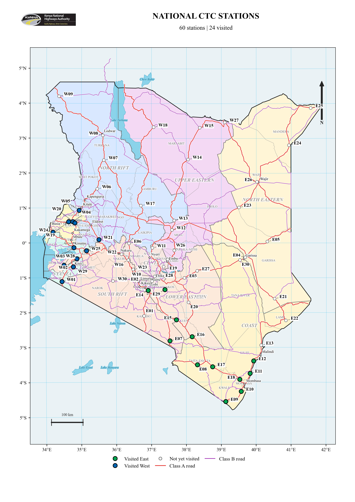

**Figure B.2 Proposed East
stations**

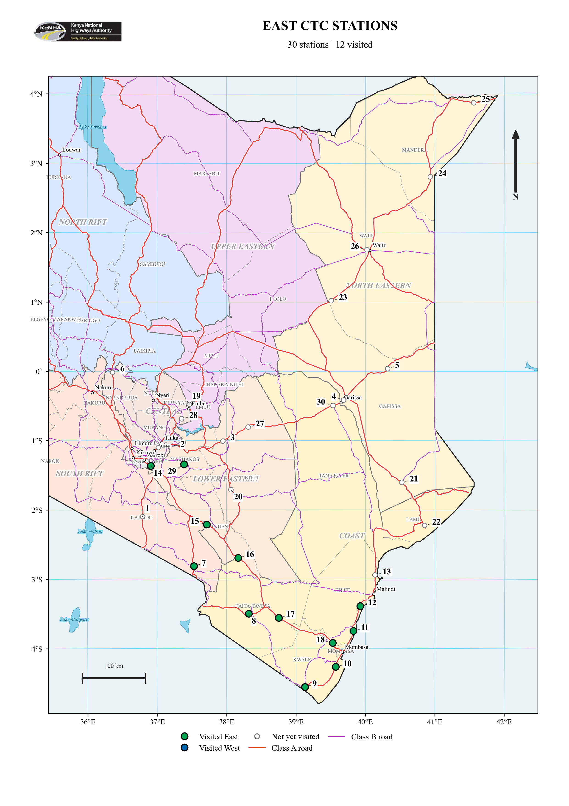

**Figure B.3 Proposed West
stations**

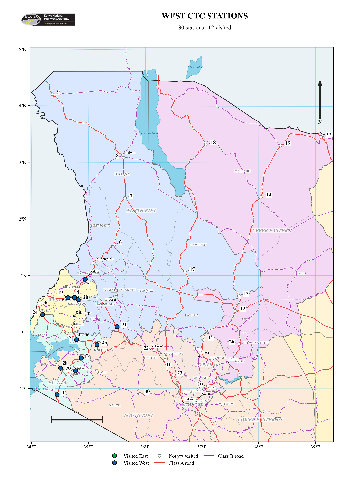

# APPENDIX C KOBO SITE VALIDATION FORM

**Kenya National Highways Authority Traffic Census Location Validation
Form**

The following is a blank reference copy of the electronic form used to
record station details, site conditions, coordinates and photographs
during the field validation exercise. An asterisk (\*) identifies a
required field.

Electronic form:
[<u>https://ee.kobotoolbox.org/x/WcfauZdU</u>](https://ee.kobotoolbox.org/x/WcfauZdU)

**A. GENERAL INFORMATION**

<table>
<colgroup>
<col style="width: 42%" />
<col style="width: 57%" />
</colgroup>
<thead>
<tr>
<th><strong>Field</strong></th>
<th><strong>Response / entry</strong></th>
</tr>
</thead>
<tbody>
<tr>
<td>Road Name *</td>
<td>Select a road section from the itinerary.</td>
</tr>
<tr>
<td>Census Station Code (if assigned)</td>
<td>________________________________</td>
</tr>
<tr>
<td>Road Section *</td>
<td>________________________________</td>
</tr>
<tr>
<td>Exercise Location *</td>
<td>West / East</td>
</tr>
<tr>
<td>Validation Date *</td>
<td>YYYY-MM-DD: ____________________</td>
</tr>
<tr>
<td>Team Leader *</td>
<td>________________________________</td>
</tr>
<tr>
<td>GPS Location (Latitude and Longitude) *</td>
<td>Capture at the proposed census station. 
Latitude (x.y degrees): __________________ 
Longitude (x.y degrees): ________________ 
Altitude (m): ______ Accuracy (m): ______</td>
</tr>
<tr>
<td>Weather</td>
<td>Clear / Sunny; Cloudy; Overcast; Rainy; Other</td>
</tr>
</tbody>
</table>

**B. LOCATION DETAILS**

<table>
<colgroup>
<col style="width: 42%" />
<col style="width: 57%" />
</colgroup>
<thead>
<tr>
<th><strong>Field</strong></th>
<th><strong>Response / entry</strong></th>
</tr>
</thead>
<tbody>
<tr>
<td>Nearest Landmark *</td>
<td>________________________________</td>
</tr>
<tr>
<td>Distance (m)</td>
<td>________________________________</td>
</tr>
<tr>
<td>Area Type *</td>
<td>Urban; Peri-Urban; Rural; Other</td>
</tr>
<tr>
<td>Road Class *</td>
<td>Class S; Class A; Class B; Other / Not Applicable</td>
</tr>
<tr>
<td>Number of Lanes *</td>
<td>________________________________</td>
</tr>
<tr>
<td>Carriageway *</td>
<td>Single Carriageway; Dual Carriageway; Other</td>
</tr>
<tr>
<td>Surface Type *</td>
<td>Paved; Gravel; Earth; Other</td>
</tr>
<tr>
<td>Road Width (m) *</td>
<td>________________________________</td>
</tr>
<tr>
<td>Speed Limit (km/h)</td>
<td>________________________________</td>
</tr>
<tr>
<td>Speed bumps *</td>
<td>Yes / No 
Are there speed bumps at or near the proposed census location?</td>
</tr>
<tr>
<td>Annual Average Daily Traffic (AADT), if known</td>
<td>________________________________</td>
</tr>
<tr>
<td>Terrain *</td>
<td>Flat; Rolling; Hilly; Mountainous; Other</td>
</tr>
<tr>
<td>Drainage *</td>
<td>Adequate; Inadequate; No Drainage; Other</td>
</tr>
<tr>
<td>Remarks</td>
<td>________________________________ 
________________________________</td>
</tr>
</tbody>
</table>

**C. SUITABILITY OF PROPOSED CENSUS LOCATION**

<table>
<colgroup>
<col style="width: 42%" />
<col style="width: 57%" />
</colgroup>
<thead>
<tr>
<th><strong>Assessment item</strong></th>
<th><strong>Response</strong></th>
</tr>
</thead>
<tbody>
<tr>
<td>Accessible to staff *</td>
<td>Yes / No</td>
</tr>
<tr>
<td>Adequate visibility *</td>
<td>Yes / No</td>
</tr>
<tr>
<td>Free from sharp bends *</td>
<td>Yes / No</td>
</tr>
<tr>
<td>Free from steep gradient *</td>
<td>Yes / No</td>
</tr>
<tr>
<td>Away from junctions *</td>
<td>Yes / No</td>
</tr>
<tr>
<td>Away from bus stages *</td>
<td>Yes / No</td>
</tr>
<tr>
<td>Away from markets *</td>
<td>Yes / No</td>
</tr>
<tr>
<td>Ongoing road works *</td>
<td>Yes / No 
Select Yes if road works are currently ongoing.</td>
</tr>
<tr>
<td>Mobile network available *</td>
<td>5G / 4G / 3G</td>
</tr>
<tr>
<td>Security acceptable *</td>
<td>Yes / No</td>
</tr>
</tbody>
</table>

**E. FIELD SAFETY ASSESSMENT**

<table>
<colgroup>
<col style="width: 42%" />
<col style="width: 57%" />
</colgroup>
<thead>
<tr>
<th><strong>Field</strong></th>
<th><strong>Response / entry</strong></th>
</tr>
</thead>
<tbody>
<tr>
<td>Parking Area *</td>
<td>Available / Not Available</td>
</tr>
<tr>
<td>Width of shoulders in metres *</td>
<td>________________________________</td>
</tr>
<tr>
<td>Remarks</td>
<td>________________________________ 
________________________________</td>
</tr>
<tr>
<td>Sign placement space *</td>
<td>Available / Not Available</td>
</tr>
<tr>
<td>Emergency Access *</td>
<td>Available / Not Available</td>
</tr>
<tr>
<td>Police station available within 5 km *</td>
<td>Yes / No</td>
</tr>
<tr>
<td>Lighting *</td>
<td>Available / Not Available</td>
</tr>
</tbody>
</table>

**G. PHOTOGRAPHIC RECORD**

| **Photograph**                      | **Electronic form attachment**  |
|-------------------------------------|---------------------------------|
| Photo - Increasing Chainage View \* | Upload image (less than 10 MB). |
| Photo - Decreasing Chainage View \* | Upload image (less than 10 MB). |
| Photo - Cross Section \*            | Upload image (less than 10 MB). |
| Photo - Equipment Point             | Upload image (less than 10 MB). |

# APPENDIX D TRAFFIC COUNT ANALYSIS SUMMARIES

## D.1 East Analysis Summary

<table>
<caption>
Table D.1 East traffic count analysis summary
</caption>
<colgroup>
<col style="width: 15%" />
<col style="width: 15%" />
<col style="width: 10%" />
<col style="width: 7%" />
<col style="width: 9%" />
<col style="width: 9%" />
<col style="width: 7%" />
<col style="width: 7%" />
<col style="width: 9%" />
<col style="width: 7%" />
</colgroup>
<thead>
<tr>
<th><strong>Station</strong></th>
<th><strong>Station code</strong></th>
<th style="text-align: center;"><strong>Count hour</strong></th>
<th style="text-align: center;"><strong>Observed 
1-hour</strong></th>
<th style="text-align: center;"><strong>2023 
reference hour</strong></th>
<th style="text-align: center;"><strong>2023 
24-hour</strong></th>
<th style="text-align: center;"><strong>HEF 
Dir. 1</strong></th>
<th style="text-align: center;"><strong>HEF 
Dir. 2</strong></th>
<th style="text-align: center;"><strong>Estimated 
ADT¹</strong></th>
<th style="text-align: center;"><strong>Change 
(%)²</strong></th>
</tr>
</thead>
<tbody>
<tr>
<td>Matsangoni</td>
<td>CST_003_A7_024</td>
<td style="text-align: center;">09:00–10:00</td>
<td style="text-align: center;">532</td>
<td style="text-align: center;">401</td>
<td style="text-align: center;">5,698</td>
<td style="text-align: center;">14.60</td>
<td style="text-align: center;">13.83</td>
<td style="text-align: center;">7,590</td>
<td style="text-align: center;">+33.2</td>
</tr>
<tr>
<td>Ukunda</td>
<td>CST_002_A7_015</td>
<td style="text-align: center;">09:00–10:00</td>
<td style="text-align: center;">1,395</td>
<td style="text-align: center;">638</td>
<td style="text-align: center;">11,046</td>
<td style="text-align: center;">17.55</td>
<td style="text-align: center;">17.08</td>
<td style="text-align: center;">24,180</td>
<td style="text-align: center;">+118.9</td>
</tr>
<tr>
<td>Lunga Lunga Police Station</td>
<td>CST_002_A7_013</td>
<td style="text-align: center;">13:00–14:00</td>
<td style="text-align: center;">251</td>
<td style="text-align: center;">168</td>
<td style="text-align: center;">1,811</td>
<td style="text-align: center;">9.06</td>
<td style="text-align: center;">12.46</td>
<td style="text-align: center;">2,696</td>
<td style="text-align: center;">+48.8</td>
</tr>
<tr>
<td>Kokotoni</td>
<td>CST_002_A8_017</td>
<td style="text-align: center;">17:00–18:00</td>
<td style="text-align: center;">943</td>
<td style="text-align: center;">575</td>
<td style="text-align: center;">9,188</td>
<td style="text-align: center;">15.58</td>
<td style="text-align: center;">16.43</td>
<td style="text-align: center;">15,156</td>
<td style="text-align: center;">+65.0</td>
</tr>
<tr>
<td>Mkomani</td>
<td>CST_003_A7_026</td>
<td style="text-align: center;">09:00–10:00</td>
<td style="text-align: center;">519</td>
<td style="text-align: center;">542</td>
<td style="text-align: center;">10,284</td>
<td style="text-align: center;">15.80</td>
<td style="text-align: center;">24.89</td>
<td style="text-align: center;">10,948</td>
<td style="text-align: center;">+6.5</td>
</tr>
<tr>
<td>Maungu</td>
<td>CST_006_A8_043</td>
<td style="text-align: center;">13:00–14:00</td>
<td style="text-align: center;">492</td>
<td style="text-align: center;">298</td>
<td style="text-align: center;">4,917</td>
<td style="text-align: center;">17.97</td>
<td style="text-align: center;">15.21</td>
<td style="text-align: center;">8,130</td>
<td style="text-align: center;">+65.4</td>
</tr>
<tr>
<td>Mwanjila Youth Polytechnic</td>
<td>CST_006_A6_042</td>
<td style="text-align: center;">17:00–18:00</td>
<td style="text-align: center;">492</td>
<td style="text-align: center;">98</td>
<td style="text-align: center;">1,988</td>
<td style="text-align: center;">12.36</td>
<td style="text-align: center;">42.23</td>
<td style="text-align: center;">9,188</td>
<td style="text-align: center;">+362.2</td>
</tr>
<tr>
<td>Mtito Andei</td>
<td>LEST_017_A8_110</td>
<td style="text-align: center;">09:00–10:00</td>
<td style="text-align: center;">547</td>
<td style="text-align: center;">108</td>
<td style="text-align: center;">2,552</td>
<td style="text-align: center;">18.08</td>
<td style="text-align: center;">30.83</td>
<td style="text-align: center;">13,409</td>
<td style="text-align: center;">+425.4</td>
</tr>
<tr>
<td>Kiboko</td>
<td>LEST_017_A8_109</td>
<td style="text-align: center;">12:00–13:00</td>
<td style="text-align: center;">469</td>
<td style="text-align: center;">258</td>
<td style="text-align: center;">2,939</td>
<td style="text-align: center;">11.85</td>
<td style="text-align: center;">10.88</td>
<td style="text-align: center;">5,360</td>
<td style="text-align: center;">+82.4</td>
</tr>
<tr>
<td>Kimana</td>
<td>NRB_034_A5_152</td>
<td style="text-align: center;">16:00–17:00</td>
<td style="text-align: center;">508</td>
<td style="text-align: center;">238</td>
<td style="text-align: center;">2,842</td>
<td style="text-align: center;">9.98</td>
<td style="text-align: center;">14.47</td>
<td style="text-align: center;">6,259</td>
<td style="text-align: center;">+120.2</td>
</tr>
<tr>
<td>Gateway Mall Syokimau</td>
<td>LEST_016_A8_098</td>
<td style="text-align: center;">13:00–14:00</td>
<td style="text-align: center;">3,532</td>
<td style="text-align: center;">5,197</td>
<td style="text-align: center;">44,085</td>
<td style="text-align: center;">9.29</td>
<td style="text-align: center;">8.02</td>
<td style="text-align: center;">30,071</td>
<td style="text-align: center;">-31.8</td>
</tr>
<tr>
<td>Mukuyuni</td>
<td>LEST_016_B63_106</td>
<td style="text-align: center;">Not supplied</td>
<td style="text-align: center;">0</td>
<td style="text-align: center;">—</td>
<td style="text-align: center;">—</td>
<td style="text-align: center;">—</td>
<td style="text-align: center;">—</td>
<td style="text-align: center;">—</td>
<td style="text-align: center;">—</td>
</tr>
</tbody>
</table>

## D.2 West Analysis Summary

<table>
<caption>
Table D.2 West traffic count analysis summary
</caption>
<colgroup>
<col style="width: 15%" />
<col style="width: 15%" />
<col style="width: 10%" />
<col style="width: 7%" />
<col style="width: 9%" />
<col style="width: 9%" />
<col style="width: 7%" />
<col style="width: 7%" />
<col style="width: 9%" />
<col style="width: 7%" />
</colgroup>
<thead>
<tr>
<th><strong>Station</strong></th>
<th><strong>Station code</strong></th>
<th style="text-align: center;"><strong>Count hour</strong></th>
<th style="text-align: center;"><strong>Observed 
1-hour</strong></th>
<th style="text-align: center;"><strong>2023 
reference hour</strong></th>
<th style="text-align: center;"><strong>2023 
24-hour</strong></th>
<th style="text-align: center;"><strong>HEF 
Dir. 1</strong></th>
<th style="text-align: center;"><strong>HEF 
Dir. 2</strong></th>
<th style="text-align: center;"><strong>Estimated 
ADT¹</strong></th>
<th style="text-align: center;"><strong>Change 
(%)²</strong></th>
</tr>
</thead>
<tbody>
<tr>
<td>A1 Isebania</td>
<td>A1.TCP23</td>
<td style="text-align: center;">09:30–10:30</td>
<td style="text-align: center;">631</td>
<td style="text-align: center;">711</td>
<td style="text-align: center;">7,040</td>
<td style="text-align: center;">8.24</td>
<td style="text-align: center;">13.53</td>
<td style="text-align: center;">6,616</td>
<td style="text-align: center;">-6.0</td>
</tr>
<tr>
<td>B3 Kogwe</td>
<td>B3.TCP1</td>
<td style="text-align: center;">15:30–16:30</td>
<td style="text-align: center;">426</td>
<td style="text-align: center;">577</td>
<td style="text-align: center;">10,035</td>
<td style="text-align: center;">24.91</td>
<td style="text-align: center;">12.12</td>
<td style="text-align: center;">7,502</td>
<td style="text-align: center;">-25.2</td>
</tr>
<tr>
<td>B6 Kereri</td>
<td>B6.TCP1</td>
<td style="text-align: center;">16:40–17:40</td>
<td style="text-align: center;">944</td>
<td style="text-align: center;">1,214</td>
<td style="text-align: center;">14,671</td>
<td style="text-align: center;">12.28</td>
<td style="text-align: center;">11.98</td>
<td style="text-align: center;">11,428</td>
<td style="text-align: center;">-22.1</td>
</tr>
<tr>
<td>A1 Oyugis</td>
<td>A1.TCP20</td>
<td style="text-align: center;">08:30–09:30</td>
<td style="text-align: center;">334</td>
<td style="text-align: center;">255</td>
<td style="text-align: center;">3,731</td>
<td style="text-align: center;">13.70</td>
<td style="text-align: center;">15.63</td>
<td style="text-align: center;">4,911</td>
<td style="text-align: center;">+31.6</td>
</tr>
<tr>
<td>A12 Bumala</td>
<td>A12.TCP1</td>
<td style="text-align: center;">14:00–15:00</td>
<td style="text-align: center;">364</td>
<td style="text-align: center;">359</td>
<td style="text-align: center;">6,330</td>
<td style="text-align: center;">18.40</td>
<td style="text-align: center;">16.82</td>
<td style="text-align: center;">6,435</td>
<td style="text-align: center;">+1.7</td>
</tr>
<tr>
<td>A8 Bukembe</td>
<td>A8.TCP1</td>
<td style="text-align: center;">16:00–17:00</td>
<td style="text-align: center;">630</td>
<td style="text-align: center;">1,190</td>
<td style="text-align: center;">12,972</td>
<td style="text-align: center;">9.05</td>
<td style="text-align: center;">13.75</td>
<td style="text-align: center;">7,149</td>
<td style="text-align: center;">-44.9</td>
</tr>
<tr>
<td>A1 Kiungani</td>
<td>A1.TCP9</td>
<td style="text-align: center;">09:00–10:00</td>
<td style="text-align: center;">508</td>
<td style="text-align: center;">452</td>
<td style="text-align: center;">5,936</td>
<td style="text-align: center;">11.69</td>
<td style="text-align: center;">15.43</td>
<td style="text-align: center;">6,894</td>
<td style="text-align: center;">+16.1</td>
</tr>
<tr>
<td>A1 Webuye</td>
<td>A1.TCP10</td>
<td style="text-align: center;">09:00–10:00</td>
<td style="text-align: center;">626</td>
<td style="text-align: center;">814</td>
<td style="text-align: center;">11,773</td>
<td style="text-align: center;">13.91</td>
<td style="text-align: center;">15.06</td>
<td style="text-align: center;">9,054</td>
<td style="text-align: center;">-23.1</td>
</tr>
<tr>
<td>A8 Chimoi</td>
<td>A8.TCP3</td>
<td style="text-align: center;">11:30–12:30</td>
<td style="text-align: center;">675</td>
<td style="text-align: center;">430</td>
<td style="text-align: center;">6,442</td>
<td style="text-align: center;">15.43</td>
<td style="text-align: center;">14.68</td>
<td style="text-align: center;">10,199</td>
<td style="text-align: center;">+58.3</td>
</tr>
<tr>
<td>A8 Eldoret Nakuru</td>
<td>A8.TCP7</td>
<td style="text-align: center;">15:00–16:00</td>
<td style="text-align: center;">600</td>
<td style="text-align: center;">1,004</td>
<td style="text-align: center;">15,043</td>
<td style="text-align: center;">12.03</td>
<td style="text-align: center;">21.08</td>
<td style="text-align: center;">9,080</td>
<td style="text-align: center;">-39.6</td>
</tr>
<tr>
<td>A1 Molem</td>
<td>A1.TCP18</td>
<td style="text-align: center;">11:00–12:00</td>
<td style="text-align: center;">1,152</td>
<td style="text-align: center;">1,774</td>
<td style="text-align: center;">25,376</td>
<td style="text-align: center;">12.73</td>
<td style="text-align: center;">18.49</td>
<td style="text-align: center;">17,971</td>
<td style="text-align: center;">-29.2</td>
</tr>
<tr>
<td>A12 Awasi</td>
<td>A12.TCP6</td>
<td style="text-align: center;">13:30–14:30</td>
<td style="text-align: center;">380</td>
<td style="text-align: center;">423</td>
<td style="text-align: center;">7,275</td>
<td style="text-align: center;">17.47</td>
<td style="text-align: center;">16.98</td>
<td style="text-align: center;">6,545</td>
<td style="text-align: center;">-10.0</td>
</tr>
</tbody>
</table>

# APPENDIX E SELECTED SITE PHOTOGRAPHS

## E.1 East

<table>
<colgroup>
<col style="width: 50%" />
<col style="width: 50%" />
</colgroup>
<thead>
<tr>
<th style="text-align: center;">
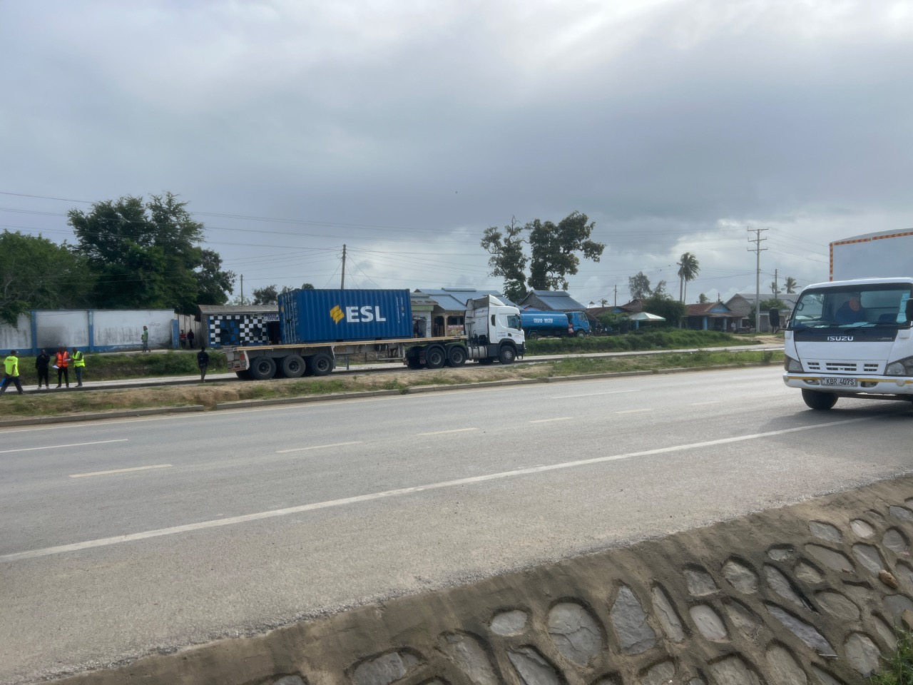

<strong>Figure E.1 Kokotoni (A8)</strong> 
Cross-section view
</th>
<th style="text-align: center;">
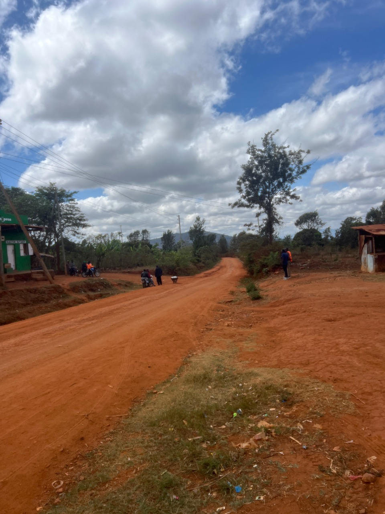

<strong>Figure E.2 Mukuyuni (B63)</strong> 
Gravel road at the assessed location
</th>
</tr>
</thead>
<tbody>
<tr>
<td style="text-align: center;">
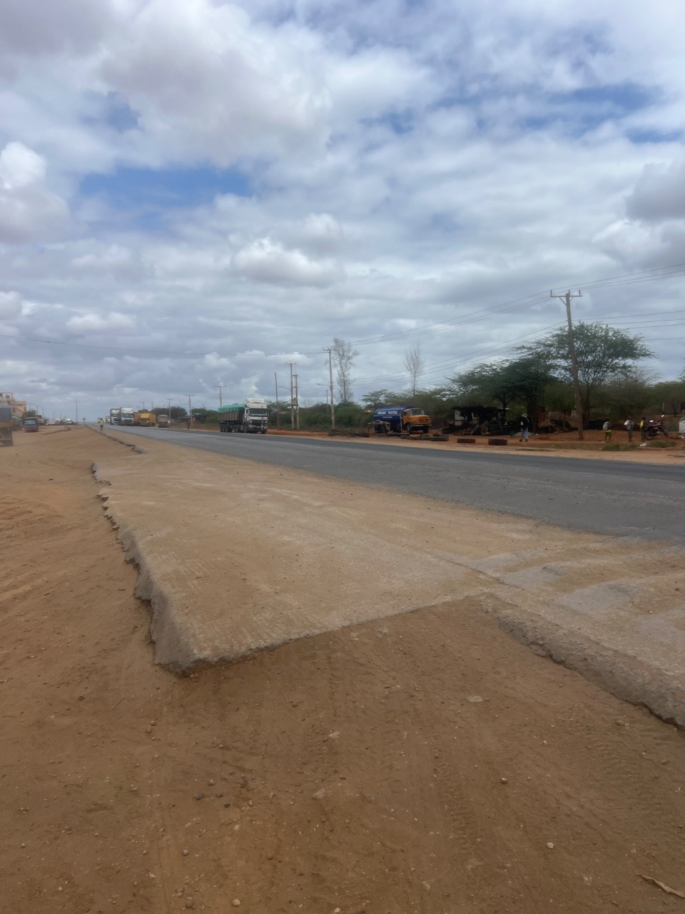

<strong>Figure E.3 Maungu (A8)</strong> 
Decreasing chainage view
</td>
<td style="text-align: center;">
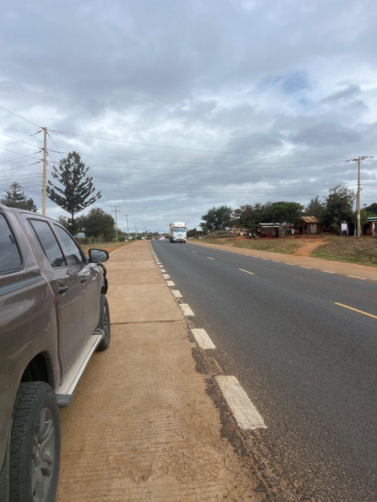

<strong>Figure E.4 Mwanjila Youth Polytechnic (A6)</strong> 
Decreasing chainage view
</td>
</tr>
</tbody>
</table>

## E.2 West

<table>
<colgroup>
<col style="width: 50%" />
<col style="width: 50%" />
</colgroup>
<thead>
<tr>
<th style="text-align: center;">
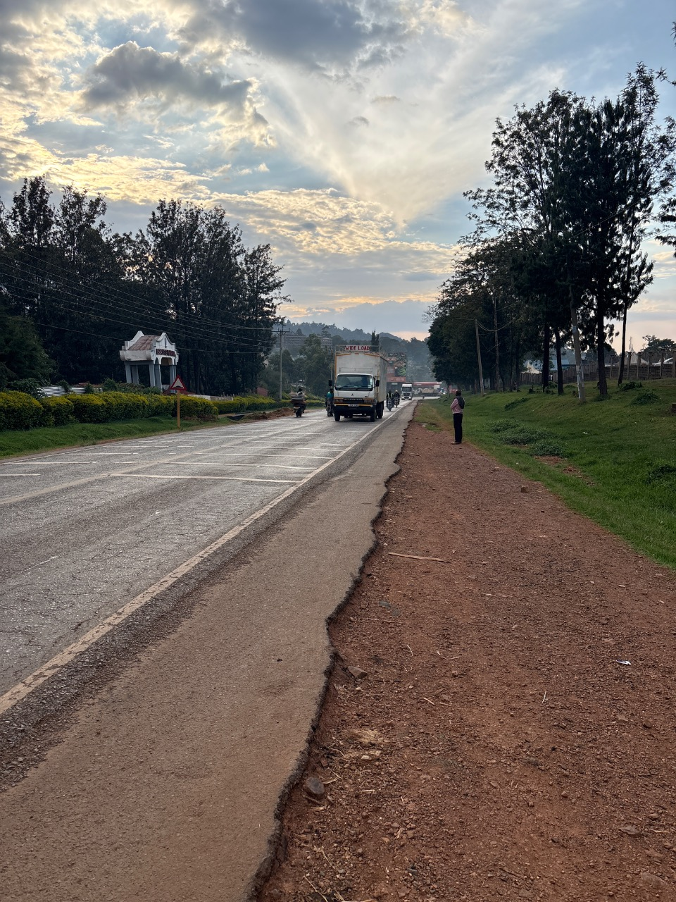

<strong>Figure E.5 Kereri (B6)</strong> 
Decreasing chainage view
</th>
<th style="text-align: center;">
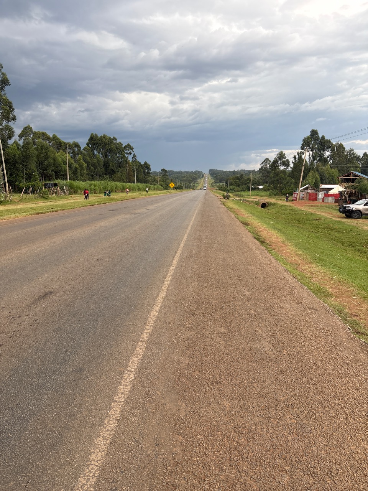

<strong>Figure E.6 Bukembe (A8)</strong> 
Decreasing chainage view
</th>
</tr>
</thead>
<tbody>
<tr>
<td style="text-align: center;">
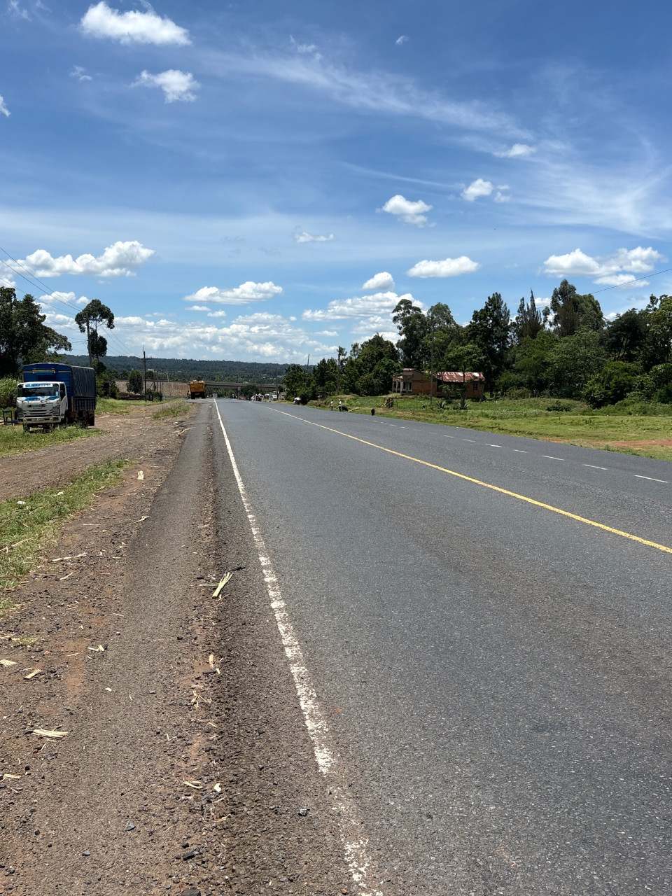

<strong>Figure E.7 Chimoi (A8)</strong> 
Decreasing chainage view
</td>
<td style="text-align: center;">
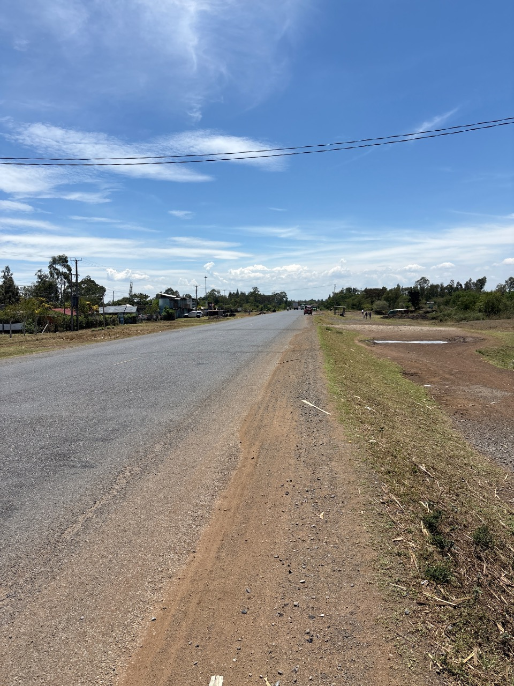

<strong>Figure E.8 Molem (A1)</strong> 
Increasing chainage view
</td>
</tr>
</tbody>
</table>
